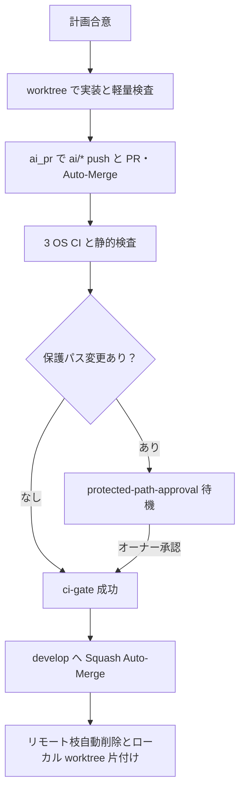

# CHG-0067: 3 OS CI と GitHub App Auto-Merge による無承認統合・自動片付け基盤

- **状態**: In progress
- **更新日**: 2026-11-27
- **基準**: `develop` `5d4342fe`（Windows 11 + Ubuntu/WSL + GitHub Free 個人公開リポジトリ）

## 要約

- 結論: Windows ネイティブ開発を維持したまま、計画合意後の実装・3 OS 検証・無承認 Squash Auto-Merge・終了後片付けを全自動化する（[ADR-0044](../adr/0044-github-app-auto-merge-and-3os-ci.md)）。
- いまの判断: 専用 GitHub App（`applejxd-dotfiles-ai`）とリポジトリ設定・`protected-path-approval` Environment の投入まで完了した。
- 次の一手: 段 1（Windows 検証 4 点・3 OS `ci-gate`・自動削除・`ai-pr` 専用入口と権限ポリシー）を実装し、実機と本物 CI ランナーで検証する。

## 目的と非目的

- 目的: Windows / Ubuntu / WSL / macOS のどの環境からでも同じ入口で開発し、保護パス以外の変更を 3 OS CI 通過後に無承認で `develop` へ統合・完全片付けできるようにする。
- 非目的: 自宅プライベート Git サーバの構築、開発環境の Linux 一本化、Closed PR 履歴の削除。

## 実施計画

| 段 | 解決したいこと | 内容 | 状態 |
| --- | --- | --- | --- |
| 0 | 方式と権限境界の確定 | 3 OS 必須チェック表・保護パス・App 登録・リポ設定・ADR-0044 | 完了 |
| 1 | Windows 検証基盤と 3 OS ゲート整備 | Win 基本 4 点修正、`ci.yml`（3 OS + `ci-gate` + 保護承認）、未マージ削除、`scripts/ai_pr.py`、権限ポリシー更新 | 進行中 |
| 2 | Ruleset 強制と実戦検証 | `develop` Ruleset 有効化、保留中の Vim SSH 修正を最初の `ai/*` PR として通し検証 | 未着手 |
| 3 | `main` 昇格と端末ロールバック | 隔離 `chezmoi apply` + 起動スモークによる `main` 昇格と、失敗時に 1 つ前へ戻す更新ラッパー | 未着手 |

状態: 未着手 / 進行中 / 完了 / 保留 / 見送り / 消滅

## 現在地

- GitHub App `applejxd-dotfiles-ai`（App ID `5955830`、Installation ID `186565652`）を Tailscale 越しの Manifest フローで作成・インストール済み（[手順記録](../research/agents/github-app-manifest-tailscale-setup-2026-11.md)）。
- `applejxd/dotfiles` で `allow_auto_merge: true`、`delete_branch_on_merge: true`、`squash_merge_commit_title: PR_TITLE`、`squash_merge_commit_message: BLANK` を設定済み。
- Environment `protected-path-approval`（Required reviewer: `applejxd`、`prevent_self_review: false`）を作成済み。
- 保留中の Vim SSH 修正は `feature/vim-ssh-clipboard` に保持しており、段 2 の最初の実験 PR として投入する。

全体の自動化フローと保護境界は次のとおりである。

## 未解決点

| 未解決点 | 再開条件 |
| --- | --- |
| Windows runner での POSIX 寄りテスト（`test_verify_stamp` 等）の挙動 | 段 1 の PR で本物 `windows-2025` ランナーを実行して確定 |
| `macos-latest` ランナーでの全テスト・ツール有無の挙動 | 段 1 の PR で本物 `macos-latest` ランナーを実行して確定 |
| Auto-Merge と `Repository admin` バイパス・`delete_branch_on_merge` の実挙動 | 段 2 の `develop` Ruleset 有効化後に実験 PR で実測 |
| 他マシンへの `app.pem` 配布（Bitwarden 連携） | 段 2 の通し検証後に別作業で整備 |

## 次の調査・実験

- 段 1 の変更で Windows 実機の `verify` / `test_verify.py`・`scripts/ai_pr.py` 単体テスト・保護パス判定テストを通す。
- 段 1 を人統合したあと本物 CI ランナー（Ubuntu / Windows / macOS）の結果を観測し、skip と 0 件収集の異常が無いことを確認する。

## 評価基準

- 必須: 共通検査の 0 件収集やツール不在による静かな skip 通過を `ci-gate` が不合格にできること。
- 必須: `.github/workflows/**` の変更は App トークンで push 不可、ガード・pi 拡張・検査基盤・`.chezmoiscripts/**` は Environment 承認なしで統合できないこと。
- 必須: 終了後にリモート `ai/*` 枝とローカル worktree が残らないこと。
- 望ましい: `AGENTS.md`・スキル・プロンプト・一般 dotfiles の PR は 1 コマンドから無承認で統合・片付けまで完了すること。

## 候補比較

| 候補 | 扱い | 要点（1 句） |
| --- | --- | --- |
| A. GitHub App + 3 OS `ci-gate` + Auto-Merge | 採用 | サーバ側境界と 3 OS 検証・自動片付けを両立 |
| B. ローカル `git flow` 維持 + Windows 修正のみ | 見送り | 他 OS 検証と無承認統合の外部ゲートが無い |
| C. Tailnet プライベート Git + 実機ランナー | 見送り | 別インフラと `$HOME` 隔離の保守費が重い |
| D. 開発環境を Linux 1 本へ集約 | 見送り | Windows ネイティブ開発の継続要件に反する |
| E. Fine-grained PAT（本人名義） | 見送り | オーナーの admin バイパス継承の懸念がある |

### 候補 A: GitHub App + 3 OS `ci-gate` + Auto-Merge

- 根拠: GitHub Free の個人公開リポジトリで Branch Rulesets・Auto-Merge・Environments（`deployment: false`）と 3 OS ランナーを無料で使える（2026-11-27 公式文書確認）。
- 不利な点・反証: Closed PR は GitHub 仕様上削除できない。また `app.pem` のローカル管理が要る。
- 未検証: 本物 3 OS ランナーでの初回全通と Ruleset 強制下の Auto-Merge 挙動。
- 次の確認: 段 1・段 2 で実測する。

### 候補 B〜E（見送り）

- 見送りの理由: 候補 B はローカル完結の限界を超えられない。候補 C は別インフラ保守が過大。候補 D は Windows ネイティブ開発を手放せない要件に反する。候補 E は別主体分離ができず Ruleset バイパス遮断の確証が持てない。

## 仕様への変更案

| 変更対象 | 変更（1 句） | 適用結果 |
| --- | --- | --- |
| `.gitattributes`・`mise.toml`・`.pre-commit-config.yaml`・`scripts/verify.py` | Windows 検証の基本 4 点を解消する | 実装済み（feature 枝） |
| `.github/workflows/ci.yml`・`cleanup-closed-ai-branch.yml` | 3 OS `ci-gate`・保護承認・未マージ削除を追加する | 実装済み（feature 枝） |
| `scripts/ci_policy.py`・`scripts/ai_pr.py` | 保護パス判定と App 認証の `ai/*` 専用入口を追加する | 実装済み（feature 枝） |
| `home/.chezmoitemplates/pi-permission-policy.json` と権限試験 | App 秘密鍵保護と `gh` 危険操作の deny を追加する | 実装済み（feature 枝） |
| `docs/spec/development.md`・`testing.md`・`AGENTS.md`・関連スキル | 新ブランチ運用と 3 OS CI 契約へ更新する | `testing.md` 更新済み（運用切替は段 2） |

## 実装・検証

- 2026-11-27（段 1）: Windows 検証基盤の基本 4 点（`.gitattributes` の `*.sh`/`*.sh.tmpl` LF、`.python-version` `3.13`、`mise.toml`/`.pre-commit-config.yaml`/`scripts/verify.py` の `uv run --no-project python` 化、`scripts/verify.py` の Windows 排他ロック修正、`scripts/lint_templates.py` の Windows パイプ LF・Linux `osrelease` 補完）を実装し、`pre-commit`（commit・pre-push 両段）と主要 pytest の Windows 実機通過を確認。
- 2026-11-27（段 1）: `scripts/ci_policy.py`（53 passed）、`scripts/ai_pr.py`（18 passed + `check-auth` で App 疎通確認）、`.github/workflows/ci.yml`・`cleanup-closed-ai-branch.yml`、権限ポリシーの保護追加（`~/.config/dotfiles-ai` と `gh` バイパス/保護変更 deny）を実装。

## 重要な更新

| 日付 | 更新 | 理由 |
| --- | --- | --- |
| 2026-11-27 | 案件を起票し段 0（App 作成・リポ設定・ADR-0044）を完了 | Windows ネイティブ開発を残した全自動統合へ移行するため |
