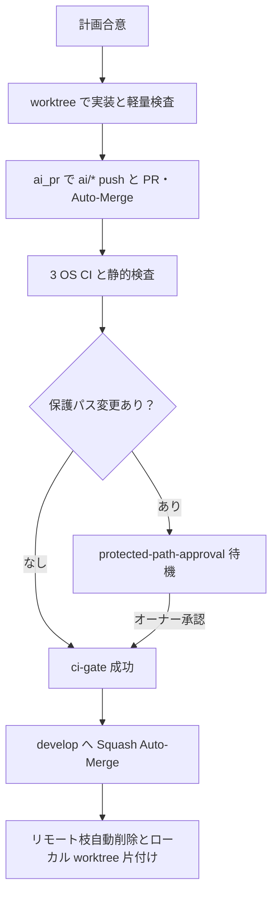

# CHG-0067: 3 OS CI と GitHub App Auto-Merge による無承認統合・自動片付け基盤

- **状態**: In progress
- **更新日**: 2026-11-28
- **基準**: `develop` `53c134fb`（Windows 11 + Ubuntu/WSL + GitHub Free 個人公開リポジトリ）

## 要約

- 結論: Windows ネイティブ開発を維持したまま、計画合意後の実装・3 OS 検証・無承認 Squash Auto-Merge・終了後片付け・隔離スモーク昇格・端末自動切り戻しを一貫整備する（[ADR-0044](../adr/0044-github-app-auto-merge-and-3os-ci.md)・[ADR-0045](../adr/0045-stage3-smoke-promotion-and-safe-update.md)・[パイプライン仕様](../spec/automation-pipeline.md)）。
- いまの判断: 段 0〜2 の全実測と、段 3 の `scripts/isolated_smoke.py`・`scripts/chezmoi_safe_update.py`・冪等修正・仕様 HTML の実装と試験まで完了した。
- 次の一手: 本 PR を統合したあと、`.github/workflows/promote-main.yml` を人手 push して 3 OS 隔離スモーク付き `main` 昇格を実測する。

## 目的と非目的

- 目的: Windows / Ubuntu / WSL / macOS のどの環境からでも同じ入口で開発し、保護パス以外の変更を 3 OS CI 通過後に無承認で `develop` へ統合・完全片付けできるようにする。
- 非目的: 自宅プライベート Git サーバの構築、開発環境の Linux 一本化、Closed PR 履歴の削除。

## 実施計画

| 段 | 解決したいこと | 内容 | 状態 |
| --- | --- | --- | --- |
| 0 | 方式と権限境界の確定 | 3 OS 必須チェック表・保護パス・App 登録・リポ設定・ADR-0044 | 完了 |
| 1 | Windows 検証基盤と 3 OS ゲート整備 | Win 基本 4 点修正、`ci.yml`（3 OS + `ci-gate` + 保護承認）、未マージ削除、`scripts/ai_pr.py`、権限ポリシー更新 | 完了 |
| 2 | Ruleset 強制と実戦検証・運用切替 | `develop` Ruleset 有効化、PR #27/#28/#29 による保護承認・無承認自動統合・未マージ削除・App 拒否・pi 実エンジン試験の実測、`cleanup --verify-github`、運用文書同期 | 完了 |
| 3 | `main` 昇格と端末ロールバック | `scripts/isolated_smoke.py`、`scripts/chezmoi_safe_update.py`、冪等修正、ADR-0045・仕様 HTML、`promote-main.yml` | 進行中 |

状態: 未着手 / 進行中 / 完了 / 保留 / 見送り / 消滅

## 現在地

- GitHub App `applejxd-dotfiles-ai`（App ID `5955830`、Installation ID `186565652`）を Tailscale 越しの Manifest フローで作成・インストール済み（[手順記録](../research/agents/github-app-manifest-tailscale-setup-2026-11.md)）。
- `applejxd/dotfiles` で `allow_auto_merge: true`、`delete_branch_on_merge: true`、`squash_merge_commit_title: PR_TITLE`、`squash_merge_commit_message: BLANK` を設定済み。
- Environment `protected-path-approval`（Required reviewer: `applejxd`、`prevent_self_review: false`、`deployment: false`）を作成済み。
- Ruleset `protect-develop-ci-gate`（ID `28273156`）が `develop` で active。適用ルールは `deletion`・`non_fast_forward`・`pull_request`（`allowed_merge_methods: ["squash"]`、`required_approving_review_count: 0`）・`required_status_checks`（`strict_required_status_checks_policy: true`、`ci-gate` / GitHub Actions `integration_id: 15368`）。`update` ルールは PR マージ自体を阻害したため除外済み（App は bypass 対象外）。
- Vim の SSH クリップボード修正（PR #28、`53c134fb`）を最初の無承認 Auto-Merge ケースとして完了し、Windows 実機へ `chezmoi apply ~/.vimrc` して iPhone SSH からの動作を確認済み。

全体の自動化フローと保護境界は次のとおりである。

## 未解決点

| 未解決点 | 再開条件 |
| --- | --- |
| 他マシン（WSL・macOS 等）への `app.pem` 配布（Bitwarden 連携） | 段 3 とは別作業で必要になったタイミングで設計・適用 |
| 旧 CI ワークフロー（`linux.yml`・`windows.yml`）の廃止判断 | `ci.yml` 運用が安定した後に人手 push で `.github/workflows/` を整理 |
| `home/dot_pi/agent/agents/**` を保護パスに残すか（フロントマターの `tools`/`permission` 保護 vs プロンプト改善頻度） | 実際のプロンプト変更頻度を見て見直す（現行は安全側で保護を維持） |
| `promote-main.yml` の初回投入と 3 OS 昇格ゲート実測 | `.github/workflows/**` は App 権限外のため利用者の人手 push 後に `workflow_dispatch` で実測 |

## 次の調査・実験

- 段 3 の PR 統合後、`.github/workflows/promote-main.yml` を人手 push し、手動トリガーで 3 OS 隔離スモーク → 承認待ち → `main` 昇格を通し検証する。

## 評価基準

- 必須: 共通検査の 0 件収集やツール不在による静かな skip 通過を `ci-gate` が不合格にできること。
- 必須: `.github/workflows/**` の変更は App トークンで push 不可、ガード・pi 拡張・検査基盤・`.chezmoiscripts/**` は Environment 承認なしで統合できないこと。
- 必須: 終了後にリモート `ai/*` 枝とローカル worktree が残らないこと。
- 望ましい: `AGENTS.md`・スキル・プロンプト・一般 dotfiles の PR は 1 コマンドから無承認で統合・片付けまで完了すること。

## 候補比較

| 候補 | 扱い | 要点（1 句） |
| --- | --- | --- |
| A. GitHub App + 3 OS `ci-gate` + Auto-Merge | 採用 | サーバ側境界と 3 OS 検証・自動片付けを両立 |
| B. ローカル `git flow` 維持 + Windows 修正のみ | 見送り | 他 OS 検証と無承認統合の外部ゲートが無い |
| C. Tailnet プライベート Git + 実機ランナー | 見送り | 別インフラと `$HOME` 隔離の保守費が重い |
| D. 開発環境を Linux 1 本へ集約 | 見送り | Windows ネイティブ開発の継続要件に反する |
| E. Fine-grained PAT（本人名義） | 見送り | オーナーの admin バイパス継承の懸念がある |

### 候補 A: GitHub App + 3 OS `ci-gate` + Auto-Merge

- 根拠: GitHub Free の個人公開リポジトリで Branch Rulesets・Auto-Merge・Environments（`deployment: false`）と 3 OS ランナーを無料で使える（2026-11-27 公式文書確認、2026-11-28 実機・実ランナーで全項目を実測確認）。
- 不利な点・反証: Closed PR は GitHub 仕様上削除できない。また `app.pem` のローカル管理と他マシン配布が要る。Ruleset に `update` 制限を入れると PR のマージまで止まる落とし穴があった（除外済み）。
- 未検証: 段 3 の `main` 昇格・端末ロールバックと、他マシンへの `app.pem` 配布。
- 次の確認: 段 3 で隔離スモークとロールバック手順を実測する。

### 候補 B〜E（見送り）

- 見送りの理由: 候補 B はローカル完結の限界を超えられない。候補 C は別インフラ保守が過大。候補 D は Windows ネイティブ開発を手放せない要件に反する。候補 E は別主体分離ができず Ruleset バイパス遮断の確証が持てない。

## 仕様への変更案

| 変更対象 | 変更（1 句） | 適用結果 |
| --- | --- | --- |
| `.gitattributes`・`mise.toml`・`.pre-commit-config.yaml`・`scripts/verify.py` | Windows 検証の基本 4 点を解消する | 適用済み（`85a32a96`） |
| `.github/workflows/ci.yml`・`cleanup-closed-ai-branch.yml` | 3 OS `ci-gate`・保護承認・未マージ削除を追加する | 適用済み（`85a32a96`） |
| `scripts/ci_policy.py`・`scripts/ai_pr.py` | 保護パス判定と App 認証の `ai/*` 専用入口・`cleanup --verify-github` を追加する | 適用済み（`85a32a96` + 本 PR） |
| `home/.chezmoitemplates/pi-permission-policy.json` と権限試験 | App 秘密鍵保護と `gh` 危険操作の deny を追加する | 適用済み（`85a32a96`、WSL 実エンジン 15/15 passed） |
| `docs/spec/development.md`・`testing.md`・`AGENTS.md`・`feature-orchestration` | 新 `ai/*` PR 運用・CI 失敗時修正上限・3 OS CI 契約へ更新する | 適用済み（`cb365df8`） |
| `scripts/isolated_smoke.py`・`scripts/chezmoi_safe_update.py`・`docs/spec/automation-pipeline.*` | 3 OS 隔離スモーク・安全更新と自動切り戻し・全体仕様 HTML を追加する | 実装済み（本 PR） |

## 実装・検証

- 2026-11-27（段 1）: Windows 検証基盤の基本 4 点（`.gitattributes` の `*.sh`/`*.sh.tmpl` LF、`.python-version` `3.13`、`mise.toml`/`.pre-commit-config.yaml`/`scripts/verify.py` の `uv run --no-project python` 化、`scripts/verify.py` の Windows 排他ロック修正、`scripts/lint_templates.py` の Windows パイプ LF・Linux `osrelease` 補完）を実装。`develop` へ `85a32a96` で統合し、Windows ネイティブ `mise run verify:all`（1,868 passed / 0 failed）を確認。
- 2026-11-28（段 2・3 OS CI と保護承認）: 初回 CI `46082432708` の Windows 1 件・macOS 16 件の失敗を PR #27（`46085908844`）で解消（static 166/0、Linux 2,188/114、Windows 1,575/66、macOS 1,694/56 passed/skipped）。`test/test_verify.py` 変更により `protected-approval` が `waiting` 停止し、オーナー承認後に `ci-gate` 成功・Deployments 0 件・`c2500be3` に Squash 統合。
- 2026-11-28（段 2・Ruleset と無承認 Auto-Merge）: Ruleset `28273156` を有効化（PR マージを止めた `update` ルールは除去）。Vim SSH 修正 PR #28（CI `46093465952`）が 3 OS・static・policy・`ci-gate` を通過、保護承認は意図どおり skip、App による無承認 Squash Auto-Merge（`mergedBy: app/applejxd-dotfiles-ai`、`53c134fb`）とリモート `ai/*` 自動削除を実測。Windows 実機への `chezmoi apply ~/.vimrc` と iPhone SSH 実機確認も完了。
- 2026-11-28（段 2・サーバ側境界・未マージ削除・実エンジン）:
  - App 認証トークンでの `develop` 直接 push が Ruleset（`GH013`）で拒否されることを実測。
  - App 認証トークンでの `.github/workflows/**` 変更 push が `workflows` 権限不足で GitHub サーバ側に拒否されることを実測。
  - 未マージ close した PR #29 のリモート `ai/probe-unmerged-close-cleanup` が `cleanup-closed-ai-branch.yml`（run `46098195529`）で自動削除され、リモート `ai/*` 0 本になることを実測。
  - `test/test_pi_permission_decisions.py` を WSL 実機（pi-permission-system + cc-safety-net 実エンジン）で実行し 15/15 passed（0 skipped）を確認（Windows 機は pi 本体の npm 展開先構成の違いで 11 件 skip）。
  - `scripts/ai_pr.py cleanup --verify-github` を追加し、GitHub PR の `merged_at` とローカル先端 SHA 一致を照合して Squash 済み `[gone]` 枝だけを安全に片付ける動作を単体試験および実 PR #28/#29/#30（`cb365df8`）で確認。
- 2026-11-28（段 3・隔離スモーク・安全更新 CLI・仕様 HTML）:
  - `scripts/isolated_smoke.py` を実装し、Windows 実機で隔離 `chezmoi init` → 2 回 `apply --exclude scripts,externals` → 残差分 0 件 → Pi JSON / gitconfig / Vim（ローカル＋`SSH_CONNECTION` ガード）/ PowerShell `profile.ps1` の起動スモーク通過を確認（`home/dot_vimrc` の `silent! colorscheme iceberg` と Keypirinha `modify_*.ini` 3 件の初回改行冪等化も同時修正）。
  - `scripts/chezmoi_safe_update.py`（隔離プレフライト → ブランチ先行移動なしの本番適用 → 失敗時の直前正常 SHA 自動ファイル切り戻し ＋ `run_*` 副作用警告 ＋ 手動 `rollback` / `status`）と状態遷移試験を実装。
  - [ADR-0045](../adr/0045-stage3-smoke-promotion-and-safe-update.md) と [パイプライン仕様](../spec/automation-pipeline.md)（および単体仕様図 [automation-pipeline.html](../spec/automation-pipeline.html)）を追加。

## 重要な更新

| 日付 | 更新 | 理由 |
| --- | --- | --- |
| 2026-11-27 | 案件を起票し段 0（App 作成・リポ設定・ADR-0044）を完了 | Windows ネイティブ開発を残した全自動統合へ移行するため |
| 2026-11-28 | 段 1・段 2 の全実測と運用文書同期を完了（PR #27〜#30） | 3 OS CI・保護承認・無承認統合・未マージ削除・`cleanup --verify-github` が揃ったため |
| 2026-11-28 | 段 3 の隔離スモーク・安全更新/自動切り戻し CLI・ADR-0045・仕様 HTML を実装 | `main` 昇格前検査と端末更新の自動復旧を揃えるため |
