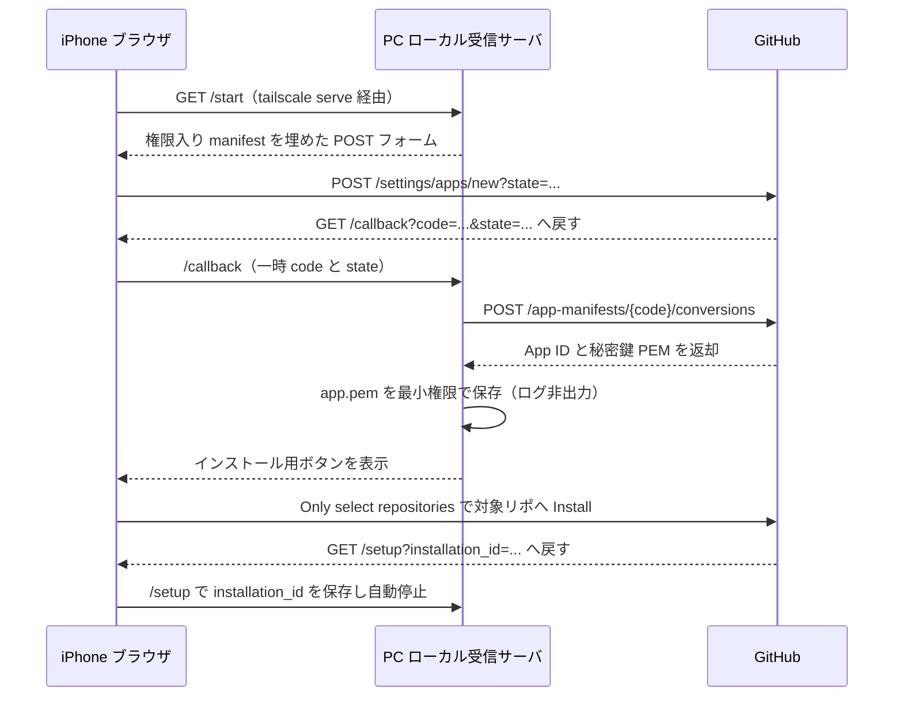

# Tailscale 越しの GitHub App Manifest 初回登録手順

- 観測日: 2026-11-27
- 結論: GitHub App Manifest フローと `tailscale serve` を組み合わせると、モバイル端末から秘密鍵をダウンロードせず 2 タップで PC へ直接保存できる。完了後は `tailscale serve` と一時サーバを必ず停止する。

## 記録 E1 — 2026-11-27

| 項目 | 値 |
| --- | --- |
| 対象機能 | GitHub App Manifest フロー・`tailscale serve` |
| 環境 | Windows 11 ホスト + iPhone（T3 Code Mobile・tailnet 内） |
| 登録結果 | App `applejxd-dotfiles-ai`（App ID `5955830`、Installation ID `186565652`） |

### 問い

モバイル端末から指示を出している状況で、端末へ秘密鍵ファイルを落とさず、手入力もせずに個人専用 GitHub App を登録・インストールできるか。

### 事前の予想

GitHub の App Manifest フローは `redirect_url` と `setup_url` へブラウザを戻すため、tailnet 限定の HTTPS URL を `tailscale serve` で一時公開すれば、モバイルのブラウザだけで登録とインストールを完結できると予想した。
未確認点は `hook_attributes.active: false` で Webhook なしの登録が通るかであった。

### 仕組みと手順

PC 側に使い捨てのローカル HTTP サーバを立て、iPhone のブラウザと GitHub の間を tailnet 経由で往復させる。



1. 既存の公開ポートを `tailscale serve status` で確認し、未使用の HTTPS ポートを選ぶ。
2. `127.0.0.1:<port>` で待つ使い捨て受信サーバに `manifest` とランダムな `state` を持たせる。
3. `tailscale serve --bg --https=<port> http://127.0.0.1:<port>` で tailnet 内だけに公開する。
4. モバイル端末で `https://<host>.<tailnet>.ts.net:<port>/start` を開き、ボタンから GitHub 側で Create GitHub App を押す。
5. 自動で戻る画面のボタンから Install に進み、対象リポジトリだけを 1 件選んで Install を押す。
6. `/setup` 受信でサーバが自動停止したら、`tailscale serve --https=<port> off` と一時スクリプトの削除を行う。

### manifest と安全の要点

今回の manifest で確認できた設定値は次のとおりである。

| 項目 | 設定値 | 意図 |
| --- | --- | --- |
| `public` | `false` | 自分のアカウント専用に限定する |
| `default_permissions` | `contents: write`, `pull_requests: write`, `metadata: read` | `workflows`・`administration`・`actions`・`deployments` を付与しない |
| `hook_attributes` | `url: "https://example.invalid/webhook-disabled"`, `active: false` | Webhook を無効にしたまま schema 必須の `url` を満たす |
| `request_oauth_on_install` | `false` | インストール時の OAuth 認可を省き、Installation Token 専用にする |
| `redirect_url` / `setup_url` | tailnet の HTTPS URL（`/callback`・`/setup`） | 登録後の `code` とインストール後の `installation_id` を PC へ戻す |

秘密鍵と一時コードを漏らさないための実装上の制約は次の 4 点である。

- `state` を乱数で発行し、`/callback` で一致しない要求を拒否する。
- HTTP アクセスログにはパスだけを記録し、`?code=...` のクエリ文字列を出さない。
- `conversions` の応答から取り出した `pem` は標準出力・ログ・HTML に一切出さず、ファイルへ直接書き出す。
- 保存直後に権限を絞る（Unix は `0600`、Windows は `icacls /inheritance:r` で本人と `SYSTEM` に限定）。

### 結果

| 観点 | 結果 | 確度 |
| --- | --- | --- |
| `hook_attributes.active: false` での登録 | 201 Created で登録・`conversions` 交換まで通過 | 実測 |
| モバイル端末への `.pem` ダウンロード | なし（PC の `~/.config/dotfiles-ai/app.pem` へ直接保存） | 実測 |
| 権限の反映 | `contents: write`, `pull_requests: write`, `metadata: read` のみ | 実測 |
| `installation_id` の自動回収 | `/setup` リダイレクトで `app.json` へ記録し自動停止 | 実測 |
| 後片付け | `tailscale serve --https=18443 off` と `.tmp/app-setup` 削除を確認 | 実測 |
| Windows の `icacls` 実適用結果 | `*.pem` の読み取り拒否ポリシーのため未検証 | 未確認 |

```text
APP_CREATED app_id=5955830 slug=applejxd-dotfiles-ai permissions={"contents": "write", "pull_requests": "write", "metadata": "read"}
APP_INSTALLED app_id=5955830 installation_id=186565652 action=install
APP_SETUP_DONE
```

### 考察

- 言えること: GitHub App の初回登録は Web UI が必須だが、Manifest フローと `tailscale serve` を組み合わせればモバイルからでも秘密鍵を端末に残さず、権限の押し間違いも防げる。
- 言えること: `tailscale serve` は既存ポートを上書きし得るため、実行前の `tailscale serve status` 確認と、終了時の対象ポートだけの `off` が必須である。
- 言えないこと: 秘密鍵の別マシンへの再配布（Bitwarden 保管と `chezmoi apply` 展開）と、保存した `app.pem` から実際に Installation Access Token を発行する動作は今回未実施である。

### 次の問い

- 保存した `app.pem` と `app.json` から短命の Installation Access Token を発行し、`ai/*` push と PR 作成、および `.github/workflows/**` 変更の拒否を実測する。
- 複数マシンで使う場合の秘密鍵の保管先（Bitwarden Secure Note 等）と権限ポリシー（`~/.config/dotfiles-ai/*` の保護）を仕様化する。

### 参照

> The manifest flow creates the GitHub App registration and generates the app's webhook secret, private key (PEM file), client secret, and GitHub App ID.

出典: [Registering a GitHub App from a manifest - GitHub Docs](https://docs.github.com/en/apps/sharing-github-apps/registering-a-github-app-from-a-manifest)（2026-11-27 確認）

> Use this endpoint to complete the handshake necessary when implementing the GitHub App Manifest flow. When you create a GitHub App with the manifest flow, you receive a temporary code used to retrieve the GitHub App's id, pem (private key), and webhook_secret.

出典: [REST API endpoints for GitHub Apps - GitHub Docs](https://docs.github.com/en/rest/apps/apps)（2026-11-27 確認）
