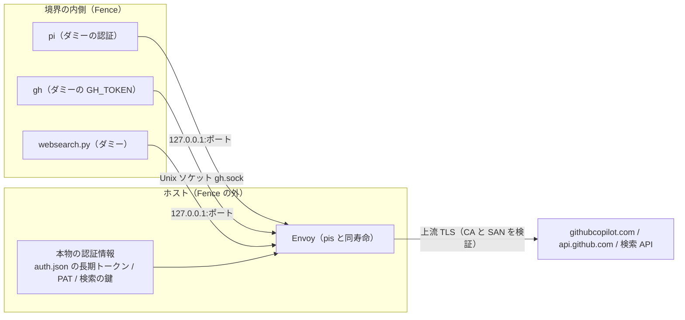

# 認証ブローカー（`pis`）

`pis`（pi を Fence で囲う起動）の、認証ブローカー（Copilot・GitHub・検索）の正本。
ホスト側の Envoy が本物の認証情報を持ち、境界の内側にはダミーか、ポートとソケットの在りかだけを渡す。
実装は `home/dot_local/share/ocs/broker.py`（Envoy の設定と寿命）、`pi.py`（起動の組み立て）、`pis.py`（`--no-broker`）。
経緯は [CHG-0037](../../change/0037-pis-usability-and-telemetry.md)、調べた記録は
[調査 D2〜D6](../../research/agents/agent-auth-delegation.md)。

## 目的と責務

- **最優先は、本物の認証キーを境界の外に置くこと**。内側のエージェントが乗っ取られても、キーそのものは持ち出せない
- **操作の防御は、外部のスコープ（GitHub の PAT の権限、IAM の権限）が担う**。ブローカーは通す先（ホスト・メソッド・パス）を
  絞るだけで、通した先での操作の内容は保証しない
- ガード（判定器）は「うっかり防止」で、境界ではない。ブローカーが境界として守るのは「キーが内側に出ない」ことと「通す先」

## 全体像

- **Envoy は 1 つだけ**。`pis` ごとに起動し、終了で止める（子側で `PR_SET_PDEATHSIG` を設定。`broker._die_with_parent`）。
  同時に複数の `pis` を起動しても、ポートと状態は別
- リスナーは有効なものだけ: Copilot = `127.0.0.1` の空きポート、GitHub = Unix ソケット（agent ディレクトリの `gh.sock`、モード 0600）、
  検索 = `127.0.0.1` の空きポート（Copilot とは別のポート）
- **設定は `broker.build_config` が Python で JSON として組み立てる**（JSON は YAML の部分集合なので Envoy がそのまま読む）。
  共通の部品は `_http_manager`（HttpConnectionManager。`normalize_path`・`merge_slashes`・アクセスログ・タイムアウト。
  `credential_injector` は SDS を渡したときだけ）、`_upstream_cluster`（LOGICAL_DNS + TLS）、`_listener`。
  以前の断片 YAML（`envoy-*.yaml`）は廃止した。旧出力との同値性は、正解データ `test/agents/golden/broker_config.json` を
  `test_broker.py::test_config_matches_the_golden_structure` が照合することで確かめる設計
  （正解データが旧出力と同値であることの確認は、この文書の作成時には読み取りだけで、確かめていない。CHG-0037 の記録を参照）
- `broker.session()` が Envoy を立てて `BrokerSession(url, state, github_socket, search_url)` を返し、抜けると止めて状態を消す。
  全リスナーの身元確認が通るまで待つ（既定 10 秒。プロキシは使わない）
- **状態ディレクトリ**（0700）: `$XDG_RUNTIME_DIR` の下、無ければ `~/.local/state/pis` の下に `pis-broker-*` を作る。
  SDS ファイル・Envoy の設定（`envoy.yaml`。**0600**、検索の鍵が入る）・ログを置く。作業ディレクトリと重なる場合は起動しない
  （`pi._reject_state_overlap`）
- 起動順: 空の agent ディレクトリの確保 → `broker.session()` → 中身の配置（`auth.json` から `github-copilot` を除く処理を
  ブローカーの起動前に通さないため）。Fence の境界へは `allowLocalOutbound=true` と、Copilot・検索のポートの
  `allowLocalOutboundPorts` を足す（`pi.apply_broker_network`）

## 設定

`common.toml.tmpl` の `[pis.broker]`（`scripts/agents/generate.py` の `pi_broker` が検証して `rules.json` の `broker` へ出し、
`pi.py` が起動時に読み直して検証する）。**環境変数では有効化しない**。未知のキー、表でない `[pis.broker]`、型違いは、
生成時（`generate.py`）も起動時（`pi.py`。fail-closed で起動拒否）も拒否する。

| キー | 値 | 既定・機ごとの値 | 備考 |
| --- | --- | --- | --- |
| `copilot` | `"off"` / `"auto"` / `"http://127.0.0.1:<1024-65535>"` | `llm-provider` が `github-copilot` の機は `auto`、他は `off` | URL は手動で立てた中継用。https・他のホスト・パス・クエリ・ユーザー情報は起動拒否 |
| `github` | `"off"` / `"auto"` | `auto`（`common.toml.tmpl`）。生成器の既定は `off` | PAT の出どころが要る（下） |
| `github_token_file` | 文字列のパス | `llm-provider` が `github-copilot` でない機は `~/.config/pis/github-token` | `github_token_command` とは両方書けない |
| `github_token_command` | 文字列の配列（argv） | 個人の機は `["gh", "auth", "token"]` | 同上。シェルを通さない |
| `search` | `"off"` / `"auto"` | `auto`（`common.toml.tmpl`）。キーを書かないと `off` 扱い | 鍵は `~/.config/agents/websearch-keys.json` |

CLI: `pis --no-broker` は**3 つとも**無効にする（設定が `auto` でも）。内側に本物の Copilot の認証が入るので、
起動時に 1 行の注意を出し、GitHub・検索が `auto` ならそれも付記する。

縮退と拒否:

| 状況 | 動作 |
| --- | --- |
| `copilot = "auto"` で Envoy が無い | 起動拒否（黙って弱くしない）。`--no-broker` で外せる |
| `github = "auto"` で PAT の出どころ無し（ファイル無し、コマンドの失敗・タイムアウト・出力過大） | **起動は止めず** GitHub ブローカーを無効にし、`GitHub 認証なし: gh は無認証になる (PAT の出どころ: …)` を出す |
| PAT のファイルの権限・所有者・形式の違反、設定の破損 | 起動拒否 |
| `search = "auto"` で鍵ファイルが無い・異常 | 起動は止めず、該当の鍵なしのプロバイダーは 503。理由を鍵抜きで通知 |
| `search = "auto"` で Envoy が無い | `copilot` と同じく起動拒否（`session()` が `BrokerError` → `die`）。未確認: 検索だけが有効で Envoy が無い機での実機の挙動 |
| CA バンドルが見つからない | 起動拒否（`find_ca_file`） |

## Copilot ブローカー

- 内側から送れる要求は、`POST /v1/messages`・`POST /responses`・`POST /chat/completions` の**完全一致のパス**だけ。
  それ以外は 403（本文 `pis-broker: path or method not allowed`）。パスは正規化・スラッシュの統合の後で照合される
- 認証: ホストの `auth.json` の `github-copilot` の長期トークン（`refresh`）で、短命の Copilot トークンを取得（`broker.exchange`）し、
  SDS ファイルへ書く。Envoy の `credential_injector` が `Authorization: Bearer <トークン>` を付ける（上書き）。
  更新は `broker._refresh_loop` のスレッドで、期限の 5 分前に取り直し、失敗したら 60 秒後に再試行する。
  ファイルは rename で置き換える（Envoy が監視）
- **上流のホスト**: トークンの `proxy-ep=` から決める（`proxy.` → `api.`、無ければ `api.individual.githubcopilot.com`）。
  `.githubcopilot.com` で終わらない・ホスト名として不正なら起動しない
- **上流の TLS は検証する**: Envoy は `validation_context` が無いと検証しないので、システムの CA（`ssl` の既定、無ければ代表的な 3 つのパス。
  見つからなければ起動しない）と、SAN の `githubcopilot.com` で終わる DNS 名を明示する
- **内側へ渡すもの**: 起動別の `auth.json` から `github-copilot` を除いて写し、終了時にホストへ戻さない。
  ダミーの `COPILOT_GITHUB_TOKEN`（環境のフィルターの後に設定）と、起動別の `models.json`（`providers.github-copilot.baseUrl`）
- **身元確認**: 起動前（Fence の外）に `GET <URL>/__pis_broker` を送り、200 で本文が `pis-broker-copilot` で始まらなければ起動しない
  （別のサービスが同じポートを占有していても使わない）
- **範囲の限界**: 外すのは `github-copilot` だけで、他のプロバイダーの認証は従来どおり内側へコピーされる。
  内側に残る Copilot の使用権（上の 3 経路）に、要求の大きさ・回数の上限は無い

## GitHub ブローカー

本物の PAT を Envoy にだけ持たせ、内側の `gh` にはダミーの `GH_TOKEN` と Unix ソケットの設定だけを渡す。

- **仕組み**: `gh` は `config.yml` の `http_unix_socket` があると、`https://api.github.com/...` を TLS なしでそのソケットへ送る
  （宛先・リポジトリ検出はそのまま。CA も MITM も `GH_HOST` も要らない）。`pi.write_gh_config` が、`GH_CONFIG_DIR`
  （agent ディレクトリ内の `gh/`）に `config.yml` を書く。ソケットは agent ディレクトリの `gh.sock`（Fence は Unix ソケットを妨げない）。
  Envoy が `Authorization` を `Bearer <PAT>` に差し替え、`api.github.com:443` へ上流 TLS（CA と SAN `api.github.com` を検証）で転送する
- **許可**: 仮想ホストは `api.github.com`（完全一致）だけを上流へ通す。他の `:authority`（`github.com`・`uploads.github.com`・偽装した Host）は
  403（本文 `pis-broker: host not allowed`。起動前の身元確認にも使う）。**メソッドとパスは制限しない**。
  内側は `gh` 以外からもソケットへ任意の HTTP を送れて、PAT の権限内の操作は原則すべて可能。防御は PAT のスコープ
- **内側へ渡すもの**: `GH_CONFIG_DIR`、ダミーの `GH_TOKEN`（ホストの `GH_TOKEN`・`GITHUB_TOKEN`・`GH_ENTERPRISE_TOKEN` は渡さない）、
  `GH_NO_UPDATE_NOTIFIER`・`GH_TELEMETRY=false`・`GH_PROMPT_DISABLED`
- **PAT の出どころ**（`github_token_file` か `github_token_command`。両方は不可）:
  - ファイル: 通常ファイル・所有者が自分・グループ／他人に権限なし（0600 相当）・4096 バイト以下・シンボリックリンクでない（違反は起動拒否。
    ファイルが無いときだけ「出どころ無し」）
  - コマンド: argv の配列、シェル無し、標準入力なし、30 秒、出力 4096 バイト以下。環境はホストのものを継承（`BW_SESSION` など）。
    標準エラーは捨てる。実行ファイル無し・タイムアウト・終了コード非 0・出力過大は「出どころ無し」
  - 値: 1 行・ASCII の印字可能文字・空白なし・255 文字以下（違反は起動拒否）。値は例外・ログ・標準エラーに出さない
- **個人の機**は `gh auth token`（`gh auth login` のブラウザ認証で保存された OAuth トークン）。権限が広く、**絞れない**（個人用の割り切り）
- **`git` の https（clone・push）には使えない**。push は現行のガードが拒否し、境界の外で行う
- **PAT の設計**（[CHG-0038](../../change/0038-guard-reclassification.md) の段 G10 の要約。**実機での確認前**で、
  特に fine-grained PAT で `gh` の各コマンドが通るかは未確認。通らないコマンドが多ければ個人機の絞り込みは取りやめる）:

  | 機 | 方針 |
  | --- | --- |
  | 個人 | fine-grained PAT（Web でしか作れない）。Metadata: Read、Issues: Write、Pull requests: Write、Contents: Read、Actions / Checks / Commit statuses: Read。Administration・Workflows・Actions Write・Secrets・Webhooks は付けない。対象リポジトリは必要な物だけ、期限は 30〜90 日 |
  | 制約のある環境 | fine-grained PAT が使えず classic PAT だけの場合がある。`repo` スコープ（必要なら `read:org`）と、リポジトリのロールが Admin でないこと。投稿だけ許して push を許さない形は作れない。保護ブランチはブランチ保護・ruleset に任せる |

## 検索ブローカー

`websearch.py` の検索を、鍵を内側へ渡さずに使うための経路（Brave・Exa・Tavily・OpenAlex・DuckDuckGo）。

### 契約

- 内側へ環境変数 `WEBSEARCH_BROKER_URL=http://127.0.0.1:<port>` を渡す（検索が有効のときだけ。ホストの同名の値は落とす）。
  起動前に `GET /__pis_broker` が 200・本文 `pis-broker-search` で始まることを確かめる
- パスの接頭辞とルート（メソッドとパスは完全一致。`websearch.py` が呼ぶものだけ）:

  | 接頭辞 | 上流 | 通す要求 | 認証ヘッダー（Envoy が付ける） |
  | --- | --- | --- | --- |
  | `/brave` | `api.search.brave.com` | `GET /res/v1/web/search` | `X-Subscription-Token: <鍵>` |
  | `/exa` | `api.exa.ai` | `POST /search` | `x-api-key: <鍵>` |
  | `/tavily` | `api.tavily.com` | `POST /search` | `Authorization: Bearer <鍵>` |
  | `/openalex` | `api.openalex.org` | `GET /works` | 鍵なし |
  | `/ddg` | `html.duckduckgo.com` | `GET` または `POST /html/` | 鍵なし |

  接頭辞を除いて上流へ中継し、Host は上流のホスト名にする。クエリはそのまま
- 認証ヘッダーは**ルートごとの `request_headers_to_add`（`OVERWRITE_IF_EXISTS_OR_ADD`）**で付ける（鍵は更新されず、ルートごとに違うため
  SDS ではなく設定ファイルへ書く）。`%` は `%%` にエスケープする
- **自分以外の認証ヘッダー**（`Authorization`・`Proxy-Authorization`・`x-api-key`・`x-subscription-token`）は、内側から来ても**削除する**。
  鍵なしの経路（OpenAlex・DDG）は、認証ヘッダーを一切通さない
- 鍵が無い Brave / Exa / Tavily は 503（本文 `pis-broker: no key for <名前>`）。未掲載の経路・メソッドは 403
  （本文 `pis-broker: path or method not allowed`）。身元確認は `GET /__pis_broker` のみ
- アクセスログは `ACCESS search <メソッド> <クエリを除いたパス> <コード>` で、クエリ（検索語）とヘッダーは出さない
- OpenAlex の鍵はクエリ認証なので、ブローカー経由では使わない（鍵なしで動く）。`fetch`（ページ本文の取得）は対象外で、ブローカーを通さない（`pis` の内側では、プロキシ越しに取る。[プロキシ越しの取得](../web-search.md#pis-の内側のプロキシ越しの取得)）

### 鍵の読み取りと隔離

- 鍵は `~/.config/agents/websearch-keys.json` を**ホスト側で**読む（`broker.read_search_keys`）。環境変数は見ない。
  鍵を要するプロバイダー（brave / exa / tavily）の値だけを拾う。通常ファイル・自分の所有・0600 相当・64 KiB 以下・
  シンボリックリンクでない、JSON のオブジェクトで、値は ASCII の印字可能文字 1〜512 文字。違反は、その鍵（ファイル全体のこともある）を
  使わず、鍵抜きの通知を出す（例外にはしない）
- 設定ファイル（`envoy.yaml`）は状態ディレクトリの中で 0600。`session()` の戻り値には URL しか入れない
- 内側からは、鍵ファイルを `[pi.sandbox] deny_read` で隠している。実測（2026-10-25、CHG-0037）: 読むと「許可がありません」。
  **`test -r` は真になる**ので、可否は実際に読んで確かめる。鍵の環境変数 4 種（`BRAVE_API_KEY`・`EXA_API_KEY`・`TAVILY_API_KEY`・
  `OPENALEX_API_KEY`）も `cli.DROP_ENV` で内側へ渡さない

### `websearch.py` 側の挙動

`home/dot_claude/skills/web-search/scripts/websearch.py`。`WEBSEARCH_BROKER_URL` があるときは、`http://127.0.0.1:<port>` の形だけを受け付け
（それ以外は終了コード 2）、各プロバイダーの URL を接頭辞つきに組み替える。鍵は探さず（ファイル・環境変数・`bw` を見ない）、
鍵が要るプロバイダーにはダミー（`broker`）を付ける。503（`pis-broker: no key for`）は「鍵が無い」と同じ扱いで、次のプロバイダーへ回る。

## 不変条件と試験

| 不変条件 | 試験（`test/agents/`） |
| --- | --- |
| Envoy の設定が正解データと一致する | `test_broker.py::test_config_matches_the_golden_structure`（`golden/broker_config.json`。`scripts/agents/export_broker_golden.py` が書き出す） |
| 上流の TLS を CA と SAN で検証する | `test_broker.py::test_config_verifies_the_upstream_certificate`、`test_github_upstream_verifies_the_certificate_and_the_exact_san` |
| Copilot は完全一致の 3 つの POST だけ、他は 403 | `test_broker.py::test_allowed_routes_are_exact_paths`、`test_real_envoy_copilot_identity_and_denials`、`test_real_envoy_copilot_allowed_posts_reach_the_upstream_cluster` |
| GitHub は `api.github.com` だけ、他の Host は 403 | `test_broker.py::test_github_listener_routes_only_api_github_com`、`test_real_envoy_github_denies_other_hosts` |
| `find_ca_file()` が無ければ拒否（検証なしで続けない） | `test_broker.py::test_missing_ca_file_refuses_to_start`、`test_session_refuses_to_start_without_a_ca_file` |
| 設定へ埋め込めないパスは拒否 | `test_broker.py::test_render_config_rejects_paths_with_quotes_backslashes_or_newlines` |
| 状態ディレクトリと作業場所の重複は拒否 | `test_broker.py::test_state_dir_overlapping_the_workspace_is_refused` |
| トークンが例外・ログに出ない | `test_broker.py::test_exchange_errors_do_not_carry_the_token`、`test_refresh_failure_is_logged_without_the_token_and_retried`、`test_token_file_with_a_bad_shape_is_refused_without_the_value` |
| PAT のファイル・コマンドの検査 | `test_broker.py` の `test_token_file_*`・`test_token_command_*`（権限・所有者・シンボリックリンク・通常ファイル・大きさ・形式） |
| `gh` の内側にダミーだけ渡す | `test_pi_github_boundary.py::test_inner_env_gives_gh_only_a_dummy_token_when_enabled`、`test_gh_config_points_at_the_socket_and_is_private` |
| 設定の検証（生成時） | `test_pi_broker_generate.py` |
| 検索: 完全一致のルート、接頭辞の除去、Host の固定 | `test_broker_search.py::test_search_routes_are_exact_paths_and_methods`、`test_search_routes_strip_the_prefix_and_set_the_upstream_host` |
| 検索: 鍵は自分のルートにだけ付く、他の認証ヘッダーは削除 | `test_each_key_is_attached_only_to_its_own_route`、`test_other_auth_headers_from_the_inside_are_removed_on_every_route` |
| 検索: 鍵なしは 503、ログにクエリと鍵なし | `test_missing_keys_answer_503_at_the_route`、`test_access_log_omits_the_query_and_headers` |
| 検索: 鍵ファイルの検査、環境変数から取らない | `test_search_keys_file_*`、`test_search_keys_are_not_taken_from_the_environment` |
| 検索: 内側の環境に URL だけ入り、鍵は入らない | `test_inner_env_gets_the_search_url_and_never_a_key` |
| 検索: `--no-broker` で検索も外れる | `test_no_broker_flag_also_drops_search` |
| 検索: 正規化・エンコードされたパスで別経路へ抜けられない（実 Envoy） | `test_real_envoy_odd_paths_never_carry_another_providers_key`、`test_real_envoy_keyless_routes_drop_every_auth_header`（`_proxy` つきも） |
| 検索: 実 Envoy で自分の鍵だけ注入、ログに鍵なし | `test_real_envoy_injects_only_the_routes_own_key`、`test_real_envoy_access_log_has_neither_the_query_nor_the_keys` |

実 Envoy の試験（`test_real_*`）は、Envoy が無い環境では skip される（`test_broker.py` の流儀。skip の条件の詳細は未確認）。
この表の試験を今回は実行していない（読み取りのみ）。

## Envoy の導入

`home/.chezmoiexternal.toml.tmpl` が `~/.local/bin/envoy` へ取得する。固定版 v1.40.1 の公式バイナリ（Linux の amd64・arm64）を
`checksum.sha256` で照合する。対象は `llm-provider` が `github-copilot` で、Raspberry Pi 以外の機。
**Bedrock（`amazon-bedrock`）の機には入らない**（このためこの機では、`github`・`search` を `auto` にしても Envoy が無く、
GitHub は起動拒否か縮退の経路に当たる。未確認: この機での実際の挙動）。
更新手順と sha256 の限界は [Envoy の取得](../structure.md#envoy-の取得)。

## 未対応・未検証

- **認証つき HTTP プロキシ（TLS 検査をするものを含む）を経由する環境での動作は未対応**。調べた事実
  （[corp-proxy-boundary](../../research/agents/corp-proxy-boundary.md) も参照）:
  - Envoy の `Http11ProxyUpstreamTransport` は CONNECT で上流につなげるが、`Proxy-Authorization` を付ける項目が無く、
    公式が「実運用の実績が少ない」と明記している（調査の記録。この文書の作成時に原典は再確認していない）
  - Fence の `upstreamProxy` は `http://` のみで、許可リストの宛先は認証つき HTTP プロキシを通らず直結する
- **設計案（推測・未検証）**: 内側はブローカーだけに出る形（Fence の許可リストを空）にし、プロキシは Envoy の側だけで使い、
  認証はローカルのブリッジ（px・cntlm）に任せ、内側に `no_proxy=127.0.0.1` を渡す。プロキシが差し替える CA（TLS 検査のとき）は上流の CA バンドルに要る
- Bedrock（`aws_request_signing`・`ConverseStream`・AgentCore の MCP 中継）は未検証。実機の確認の手順と、Copilot との機能差の一覧は [Bedrock ブローカーの実機確認](../../research/agents/bedrock-broker-field-test.md)
- 制約のある環境の機での本物の PAT による `gh` は未確認。本物の PAT での成功は、個人の機の `gh auth token`（OAuth）でのみ確認した
- SDS の 24 時間後の再読み込み（トークンの有効期限切れ後の更新）は未確認（CHG-0037 の段 U7a の記録）
- 要求の大きさ・回数の上限は無い（Copilot・検索とも）

## 実測と経緯

- **2026-10-24**（WSL2、境界あり）: ダミーの `COPILOT_GITHUB_TOKEN` と `models.json` の `baseUrl` だけで、`pis -p` が Copilot の応答を受け取れた。
  ストリーミングは増分で届いた。許可した 3 経路は 200、GET・別パス・`/../models`・`/chat/completionsx` は 403
- **2026-10-24**（WSL2、境界あり、ダミーの PAT）: 内側の `gh issue list` が `gh.sock` 経由で Envoy に届き、GitHub が `HTTP 401: Bad credentials` を返した
  （差し替え値がダミーのため。経路の成立の証明）。偽装した Host は 403。PAT が無いときは通知を出して `gh` は無認証
- **2026-10-24**（個人の機、境界あり）: `github_token_command = ["gh", "auth", "token"]` で、内側の `gh issue list -R cli/cli -L 2` が実際の issue を返した
- **2026-10-25**: 鍵ファイルは、内側から読むと「許可がありません」（`test -r` は真）
- **2026-10-25**（個人の機、境界あり）: `pis -p` の内側から `websearch.py search` が通った（`provider=brave`、8 件）。内側に鍵は渡っていない。
  独立の `review` の指摘（身元確認を GET に限定、`Proxy-Authorization` の削除、不正なパス・エンコードの実 Envoy の試験）を反映した
- **2026-10-25**: 共通化の前後で `build_config` の出力が同値であることを、HEAD の旧コード（断片 YAML と旧 `broker.py`）を `git show` で取り出して書き出した構造と、正解データ `golden/broker_config.json` のバイト一致で確かめた
- 詳しい経緯は [CHG-0037](../../change/0037-pis-usability-and-telemetry.md)、方式の調査は
  [調査 D2〜D6](../../research/agents/agent-auth-delegation.md)
