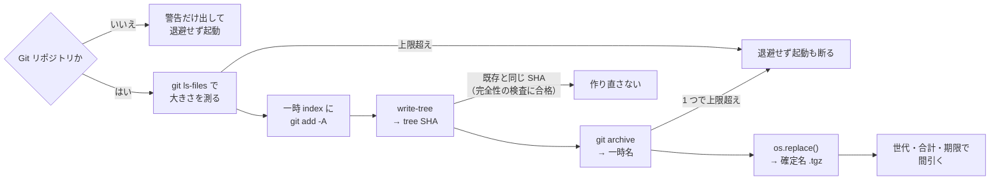

# Fence 境界の組み立て（`pis` と `ocs` が共有）

`pis`（pi をサンドボックスの中で起動する）と `ocs`（OpenCode の隔離起動）が**共有する Fence の境界**の仕様: 境界の組み立ての規則、起動ディレクトリの制限、保護対象、プロジェクトごとの追加、環境変数での追加、起動前の退避、境界チェック、信頼の鎖、版の扱い。

- OpenCode の隔離起動（`ocs`）だけの仕様（DB の共有・セッションの引き継ぎ・隔離版設定・エージェントとコマンド）は [OpenCode 隔離起動](opencode-sandbox.md)（撤去予定。CHG-0020 段 6 は保留中）
- `pis` の使い方と pi のガードは [pi のガード](../guard/pi-guard.md#サンドボックス)。サンドボックスの総覧は [サンドボックス](index.md)

## 境界の中身

Fence へ渡す設定（`fence.json` の形）は、共通の素材 + 起動ディレクトリから毎回組み立てる。
素材は `common.toml.tmpl` の `[opencode.sandbox]`。

| 区分 | 内容 |
| --- | --- |
| `defaultDenyRead` | `true`。読み取りは既定で拒否し、下の `allowRead` と書き込み先だけを開ける |
| `allowRead` | 起動ディレクトリ、`read`（道具の置き場: `~/.opencode`、`~/.local/share/mise`、`~/.local/bin`、`~/.config/opencode/{guide-plugin,checkpoint-plugin,skills}`、`~/.config/{opencode-sandbox,shell,mise,chezmoi,git}`、`~/.gitconfig`、`~/.claude/skills`、`~/.agents/skills`）、`work_read`（作業用の親ディレクトリ: `~/src`・`~/worktrees`・`~/papers`・`~/.local/share/chezmoi`） |
| `allowWrite` | 起動ディレクトリ、`write`（`~/.cache`）、`XDG_DATA_HOME/opencode`、worktree の共有 `.git` |
| `denyRead` | 開けた場所の内側にある秘密（`deny_read` と `[sandbox] deny` のうち glob でないもの） |
| `denyWrite` | [保護対象](#保護対象denywrite)、worktree の共有 `.git` の `hooks` と `config` |
| `network` | 通信を許可したドメインのみ（**モデル提供元を入れ忘れると応答が来ない**）。接続先は `[provider.*]` から `providers` で引く（[CHG-0007](../../change/0007-harness-profiles.md)） |
| `allowPty` | `true`。TUI のリサイズを内側へ伝える |

### 組み立ての規則

- **無いパスは渡さない。** `read`・`work_read`・`write` は起動時に在るものだけを使う。
  機械ごとに `~/papers` などが無くてよい
- **読める場所を並べる形にする。** 「全部読めて秘密だけ名指しで隠す」形では、
  新しくできた秘密の置き場が既定で見える。`work_read` には秘密を置かない場所だけを書き、
  **中に紛れた秘密は読める**ことを受け入れる（ADR-0012）
- **`~/.config/opencode` は丸ごと開けない。** `service.json`（常駐サービスの接続情報）が
  ある。要る plugin とスキルだけを開ける
- **`denyRead` は、ホーム配下なら開けた場所の内側にあるものだけを渡す。**
  開けていない場所は元から見えない。ホームの外（`/run/user` など、Fence が既定で
  見せる場所）は在れば渡す。例: `~/.config/chezmoi` を開けているので
  `~/.config/chezmoi/key.txt`（age の秘密鍵）は `/dev/null` で隠れる。
  内側かどうかは symlink を解いた実体でも比べ、Fence へは実体で渡す（ホームが symlink だと
  起動ディレクトリは実体になるため）。実体がホームの外にある秘密は、ホームの外として扱う
- **Fence が既定で読ませる場所がある。** `/usr`・`/etc`・`/opt`・`/run` などのシステムの
  パスと、`~/.local/bin`・`~/.cargo/bin`・`~/.rustup`・`~/.nvm` などの道具の置き場。
  `/run/user`（常駐サービスや agent のソケット）は `deny_read` で隠す
- **`~/.bashrc`・`.gitconfig` などは Fence が読み込み専用にする。** 開けていないものは
  `/dev/null` で潰され、名前だけ見える
- **`/tmp` は内側だけの tmpfs。** 書けるがホストへは反映されず、終了時に消える
- **Fence には必ず `--settings` を渡す。** 省くとカレントディレクトリとその親から
  `fence.json` を探すので、リポジトリが境界を決められてしまう

> WSL の `/mnt/c` は `defaultDenyRead` で見えない（存在も分からない）。
> `/mnt/d` などを使うときは `.opencode/sandbox.toml` で開ける
> （[プロジェクトごとの追加](#プロジェクトごとの追加)）。

### 起動ディレクトリの制限

起動ディレクトリは無条件に書ける。そこで次の 2 つのキーで起動する場所を制限する。

- **`unsafe_workspace`: 項目そのもの、またはその祖先では起動しない**
  （`~`・`/mnt`・`/tmp`・`/var/tmp`・`/dev/shm`）。子孫（`~/work/repo` など）は許す
- **`control_dirs`: 項目そのもの・祖先・子孫のどれでも起動しない**。配備済みの制御ファイルの
  置き場（`~/.local/share/ocs`・`~/.local/bin`・`~/.config/opencode`・`~/.config/opencode-sandbox`・
  `~/.config/agents`）と `ocs` の状態領域（`~/.local/state/opencode-sandbox`）。
  中に次回の境界や permission を決めるファイル（ランチャーの本体、`guide-plugin/rules.json`、
  隔離版の設定、`local.toml`）や退避があり、
  どの向きに重なっても書けてしまうため。`.opencode/sandbox.toml` の `write` が置き場と
  重なるとき（どちら向きでも）も起動しない。ここの編集は `ocs` を使わずに行う

2 つに分けるのは、`unsafe_workspace` を双方向の比較にすると `~` の子孫まで拒否してしまうため。
配備先を祖先だけの比較（`unsafe_workspace`）に置くと、子孫（`~/.config/opencode/guide-plugin`）での
起動が通り `rules.json` が書ける。配備先はリポジトリ用の相対パスで解く
[保護対象](#保護対象denywrite)に当たらないので、ここで止める。

比べるときは項目を**実体パスへ正規化する**（起動ディレクトリは実体パスになるため）。
ホームが `/home/u -> /data/u` の symlink でも、`/data/u` やその祖先での起動を拒否する。
`~/.config/opencode` が別の場所への symlink なら、その実体の中や祖先での起動も拒否する。
途中が無いパスは、在る所まで symlink を解いて比べる。

| 起動ディレクトリ | 判定 | 理由 |
| --- | --- | --- |
| `~`、`/home`、`/` | **拒否** | ホーム全体が書ける |
| `~/.local/share`、`~/.config` | **拒否** | 制御ファイルの置き場の祖先 |
| `~/.config/opencode`、`~/.config/opencode/guide-plugin` | **拒否** | 制御ファイルの置き場そのもの・その中 |
| `/tmp`、`/mnt` | **拒否** | ホストの `/tmp` や Windows 側が書ける |
| 保護対象そのもの、またはその中 | **拒否** | 起動ディレクトリは塞げない（[保護対象](#保護対象denywrite)） |
| `~/work/repo`、`/tmp/scratch`、`~/.local/share/chezmoi` | 許可 | 書ける範囲がそこに留まり、制御ファイルの置き場と重ならない |

`.opencode/sandbox.toml` の `write` が保護対象の中を指すときも起動しない
（[保護対象](#保護対象denywrite)）。
いずれの拒否も境界を組み立てる前に行い、設定の書き出し・退避・起動（`--check` も）へ進まない。

### 保護対象（`denyWrite`）

「次回の隔離起動で、実行コード・境界設定・緩和設定の選択を決める入力一式」。
ファイル名の列挙ではなく**信頼の鎖から導出する**。相対パスで書き
（`[opencode.sandbox] protected`）、**起動ディレクトリと、それを含むリポジトリの根
（`git rev-parse --show-toplevel`。linked worktree ならその worktree の根）の両方を基準に**
解決する。下位ディレクトリ（`home/` など）で起動しても、根から見た保護対象を塞ぐため。

- `home/dot_config/agents`（permission / hook / 境界の単一ソース）
- `home/dot_config/opencode/guide-plugin`（生成される判定表）
- `home/dot_local/bin`（ランチャーの入口と境界チェック）
- `home/dot_local/share/ocs`（ランチャーの本体。[構成](#ランチャーの構成)）
- `scripts/agents`（生成器）
- `home/dot_config/mise`（Fence の版を決める）
- `.opencode`（置かれると自動ロードされる）

解決した保護対象は、書ける場所との位置関係で扱いを分ける。比べるときは保護対象も
書ける場所も**在る所まで symlink を解いた実体パス**にする（起動ディレクトリは実体パスになるため。
[起動ディレクトリの制限](#起動ディレクトリの制限)と同じ考え方）。

| 保護対象の位置 | 扱い |
| --- | --- |
| 書ける場所（起動ディレクトリ・`.opencode/sandbox.toml` の `write` など）の中 | `denyWrite` に入れる |
| 起動ディレクトリそのもの、またはその祖先 | 起動を拒否する（ここの編集は `ocs` の外で行う） |
| `.opencode/sandbox.toml` の `write` そのもの、またはその祖先 | 起動を拒否する（`write` から外すよう表示する） |
| いずれでもない | 元から書けないので渡さない（作りもしない） |

`write` が保護対象の中を指す宣言（例: `docs` で起動して `../scripts/agents/generate.py`）を
拒否するのは、塞げばその `write` は書けず、塞がなければ保護対象の一部が書けるため。
保護対象を含む広い `write`（`..` など）は中の保護対象を塞げるので、そのまま通す。

`denyWrite` へは実体パスを渡す。保護対象が symlink（例: `home/dot_local/share/ocs` が
同じリポジトリの別の場所を指す）なら参照先を塞ぎ、symlink 経由の書き込みもそこで止まる。
Fence も `denyWrite` を実体へ解いてからマウントする（上流の `main` の `resolvePathForMount`。
`v0.1.67` での実測はしていない）。
symlink の項目そのもの（親ディレクトリの中の名前）は塞げないので、親が書ければ
symlink を消して置き換えることはできる（悪意ある操作は[非目的](../../adr/0012-ocs-boundary-for-accidents.md)）。

OpenCode は起動ディレクトリから Git の根まで遡って `.opencode` を読む。`ocs` が塞ぐのは
起動ディレクトリと根の `.opencode` だけで、根の `.opencode` の中での起動は上の表で拒否する。
その間（`repo/a/.opencode` など）は、追加の `write` が無ければ書ける場所の外にある。
`write = [".."]` のように広げたときは塞がれない。中間の `.opencode` や、起動ディレクトリと根
以外のプロジェクト設定まで守る仕組みではない。

**Fence の `denyWrite` はまだ無いパスに効かない**（[実測](../../research/opencode/permission/fence.md)の 4'）。
そこで `ocs` は、無い保護対象のうち**親が在るものを空のディレクトリとして先に作ってから**
塞ぐ。`.opencode` は起動ディレクトリに必ず作られる（空のディレクトリは `git status` に
出ない）。親が無いもの（このリポジトリ以外での `home/dot_config/agents` など）は、
その起動ディレクトリでは守る意味が無いので渡さない。塞いだディレクトリは
マウントポイントなので、内側から消したり名前を変えたりもできない。

> 変更できる生成器から保護対象を次回上書きできるなら、その保護は迂回されている。
> これらを編集するときは**境界の外**で行う。

#### 制御ファイルの保護が効く範囲

この dotfiles の制御ファイル（permission・境界・ランチャーの単一ソースと、その配備先）が
境界の内側から書けないのは、次の範囲だけ。この文書・[セキュリティ](../security.md)・
[ADR-0012](../../adr/0012-ocs-boundary-for-accidents.md) で「書けない」「守る」と書くときは、
すべてこの範囲を指す。

| 対象 | 守り方 | 効く範囲 |
| --- | --- | --- |
| source state（`protected`） | 起動ディレクトリとその Git の根から相対で解き、書ける場所の中なら `denyWrite`。中での起動と中を指す `write` は拒否 | 起動ディレクトリを含むリポジトリ（linked worktree ならその worktree）の中 |
| 配備先（`control_dirs`） | 重なる場所での起動と、重なる `write` を拒否（[起動ディレクトリの制限](#起動ディレクトリの制限)） | `ocs` を通した起動すべて |

対象外。

- **精査していない `.opencode/sandbox.toml` の `write` で別の場所を開けた場合。** 起動ディレクトリの
  Git の根の外（別のクローンや `~/.local/share/chezmoi` など）にある source state は、保護対象として
  解かれないので塞がない。配備先と重なる `write` だけは拒否する
- 起動ディレクトリと根の間にある中間の `.opencode`、symlink の項目そのものの置き換え（上記）
- 利用者自身が `[opencode.sandbox] write` や `XDG_DATA_HOME` を配備先へ向けた場合
  （[ADR-0012](../../adr/0012-ocs-boundary-for-accidents.md) の非目的「利用者自身の明示的な上書き」）

### プロジェクトごとの追加

`<起動ディレクトリ>/.opencode/sandbox.toml` に書くと、その起動ディレクトリでだけ足す。
宣言がリポジトリと一緒に移動し、パスがマシン依存にならない。

```toml
read = ["/mnt/d/datasets/example"]
write = ["/mnt/d/outputs/example"]
network_allow = ["api.example.com"]
devices = ["/dev/dxg"]
```

- **確認なしで適用し、起動時に足す分を表示する。** 承認の記録は持たない
- 知らないキー・文字列の配列でない値があれば起動しない
- `~` は展開し、相対パスは起動ディレクトリ基準にする (`devices` を除く。下記)
- 親ディレクトリの宣言は子に効かない（起動ディレクトリのものだけを見る）
- `.opencode` は保護対象なので、内側から宣言を書き換えることはできない

#### `devices` (デバイスを境界の中へ見せる)

Fence の `devices.allow` へ渡す。WSL の GPU は `/dev/dxg`、ネイティブの Linux の NVIDIA は
`/dev/nvidiactl`・`/dev/nvidia0`・`/dev/nvidia-uvm` など。

- **既定は無効。** どちらも無ければ `devices` を設定に作らない (Fence は `mode: auto` で、`/dev` は最小)。
  足すときだけ `{"mode": "minimal", "allow": [...]}` を設定へ入れる (`auto` の挙動に依存しないため)
- **書式**: `~` を使わない絶対パスで、`/dev/` 直下の名前 1 つだけ (`/dev/dxg`)。`..`・`//`・余計な階層・
  `/dev` 自体・末尾の `/` は拒否する。glob (`* ? [`) も拒否する (Fence の README に `devices.allow` が
  glob を受ける記述が無く、未確認のため)。起動ディレクトリ基準の展開はしない
- **許可リスト方式** (`boundary.ALLOWED_DEVICE_NAMES` と `ALLOWED_DEVICE_PATTERN`。`/dev/` 直下の名前を、完全一致の集合と
  `re.fullmatch` で照合する。大文字小文字を区別): CUDA の計算に要るものだけ。
  `dxg` (WSL の GPU)・`nvidiactl`・`nvidia[0-9]+` (`nvidia0`・`nvidia12`。`nvidia0abc`・`nvidia` 単体・
  `nvidia-foo` は通さない)・`nvidia-uvm`・`nvidia-uvm-tools`。**これ以外はすべて拒否**し、許可リストに無い
  要素と許可する名前の一覧を示して起動しない
- **外した名前**: `dri`・`kfd`・`nvidia-modeset`・`nvidia-caps` は許可リストに入れていない（[理由と実測](../../research/opencode/opencode-sandbox-spec-notes.md#devices-の許可リストから外した名前)）。必要になったら、公開範囲を確かめたうえで、一覧に足す変更をする
- 一覧に足すには `ocs` (`boundary.py`) の変更が要る。利用者の設定では足せない
- **許可リスト方式であり、拒否の一覧方式ではない。** 一覧に無い名前は、GPU 以外（`/dev/snd`・`/dev/kvm`・`/dev/ttyS0` など）も含めてすべて拒否する（[判断の経緯](../../research/opencode/opencode-sandbox-spec-notes.md#devices-の拒否の一覧方式を採らなかった判断)）
- **存在しないデバイスは、Fence が黙って無視する** (実測。エラーにならない)。`ocs` は存在を確かめない。
  名前を間違えても起動はするが、GPU は使えない
- 実測: `allow: ["/dev/dxg"]` だけで、`/dev` に `dxg` が 1 つ加わる。標準のデバイスは残り、`nvidia-smi` が通り、
  CUDA の `cuInit` が 0 を返した
- **文字列の検査は形まで。** 許可名が `/dev` で symlink のときの参照先は見ない
- **`.opencode` が symlink の場合の限界**: 上の「保護対象が symlink なら、書ける親からリンクを置換できる」
  は `.opencode/sandbox.toml` の `devices` にも当てはまる。通常のディレクトリなら、内側からの新規作成・
  編集は塞がっている (`.opencode` は `denyWrite`)。symlink の場合の悪意ある操作は非目的
  ([ADR-0012](../../adr/0012-ocs-boundary-for-accidents.md)) の範囲として許容する
- **設計の判断**: 環境変数だけにして `sandbox.toml` には足さない、というより小さい設計も検討した。
  プロジェクトごとの GPU 要件を共有する用途があるため、両方を残した
- **`/dev/dxg` を許すと、Windows の GPU ドライバへの経路が境界の内側に開く。** 影響は未評価のまま
- worktree 隔離 ([CHG-0029](../../change/0029-worktree-isolation.md)) の子の Landlock の書込可にも、
  同じデバイスが要る (そちらで扱う)

### 環境変数での追加

`PIS_EXTRA_READ` で、起動のたびに読み取りの許可を足せる。マシンごとにデータセットの置き場が違うとき、
リポジトリ (`.opencode/sandbox.toml`) へパスを入れずに、シェルの設定だけで済ませるためのもの。
`pis` と `ocs` (OpenCode) の両方で同じ実装が効く。

```sh
export PIS_EXTRA_READ="$HOME/dataset:/data2"
```

- **書式**: コロン区切りのパスの一覧。空の要素は無視する。`~` は展開する
- **絶対パスだけ**: 相対パスは基準のディレクトリが無いので、起動を拒否し、不正な要素を表示する
- **read 専用**: `write`・`network_allow` は環境変数では足せない
- **取り込み**: `.opencode/sandbox.toml` の `read` の後ろに足す (重複は 1 つにまとめる)。
  ファイルが無くても、環境変数だけで効く
- **検査**: 起動ディレクトリ・`write` に効く検査 (制御ファイルの置き場・保護対象) は、`read` には
  かからない。秘密は `denyRead` が隠す (`PIS_EXTRA_READ` で開けても `denyRead` は残す。
  Fence 側で `denyRead` が `allowRead` に勝つ点は未確認)
- **表示**: 起動時に足す分を表示し、環境変数由来のものには `(PIS_EXTRA_READ)` を付ける
- **リンク**: Fence はリンクを辿って許可を広げない。リンクのあるディレクトリと実体の両方を
  指定する ([CHG-0029](../../change/0029-worktree-isolation.md) の「データセットの読み取りと GPU の調査」の実測)
- **内側から広げられない**: 環境変数は起動ラッパーが Fence の外で、起動前に読む。内側の環境には
  渡さない (`cli.DROP_ENV`、pi も併用)。内側のエージェントが次回の起動の環境を変える経路は
  無いと見ているが、利用者のシェルの設定ファイルを書けるかは別の話で、ここでは確かめていない (推測)

`PIS_EXTRA_DEVICES` で、`devices` ([プロジェクトごとの追加](#プロジェクトごとの追加)) を足せる。

```sh
export PIS_EXTRA_DEVICES=/dev/dxg                                  # WSL の GPU
export PIS_EXTRA_DEVICES=/dev/nvidiactl:/dev/nvidia0:/dev/nvidia-uvm  # ネイティブの Linux
```

- 書式はコロン区切り。検証・許可リスト・既定 (無効) は `devices` と同じ。不正な要素は表示して起動しない
- `.opencode/sandbox.toml` の `devices` の後ろに足す (重複は 1 つ)。表示には `(PIS_EXTRA_DEVICES)` を付ける
- 起動ラッパーが Fence の外で読み、内側へは渡さない (`cli.DROP_ENV`)。`write`・`network_allow` は
  環境変数では足せない

### Copilot ブローカー（`pis` のみ）

正本は [ブローカー](broker.md#copilot-ブローカー)（設定・許可する経路・上流の TLS・身元確認・範囲の限界）。

### GitHub ブローカー（`pis` のみ）

正本は [ブローカー](broker.md#github-ブローカー)（`gh` の Unix ソケット・PAT の出どころと検査・縮退・PAT の設計・実測と未確認）。

## 起動前の退避

境界は**ワークスペースの中を守らない**。未コミットの変更は `snapshot` でも
git でも戻せないことがあるので、起動のたびに複製を境界の外へ出す。



- **作業ツリーには触らない。** `git stash` とは別物で、一時 index に `add` して
  tree を書くだけ。再開時に変更が巻き戻ることはない
- **`.gitignore` が効く。** キャッシュなどは入らない。
  裏を返すと、**無視されているファイル（`.env` など）は保護されない**
- **同じ内容なら同じ tree SHA** になるので、中断と再開を繰り返しても溜まらない
- **書き終えるまで確定名（`*.tgz`）を付けない。** `git archive` は同じ置き場の
  一時名（`.<確定名>.<乱数>.partial`）へ書き、上限の確認の後に `os.replace()` で
  確定名へ置き換える。確定名に直接書くと、途中で強制終了したときの不完全な
  ファイルが次回の重複判定に当たり、退避しないまま起動してしまう。
  重複判定・間引き・期限は確定名だけを数える
  - 一時名の残骸は、次に退避を作ったときに**最終更新から 1 時間を過ぎたものだけ**
    片付ける。新しいものは同時に起動した別の `ocs` が書いている途中かもしれない。
    書き込み中は更新時刻が進むので、1 時間止まっていれば残骸とみなせる
  - 重複判定に当たった退避は、**gzip を末尾（CRC と長さ）まで読めるか**確かめ、
    読めなければ消して作り直す。展開したデータが 0 バイト（空のファイル）も不完全とみなす
    （`git archive` の tar は空にならない）。一時名の導入前の版が確定名で残した不完全な退避と、
    置き換えの直後の電源断などで中身が揃わなかったものを拾う。
    読むのは当たった 1 件だけで、大きさは起動ディレクトリごとの上限（128 MiB）で
    押さえられる。tar としての検査はしない（gzip が末尾まで読めれば途中で
    切れてはいない）
- **大きさは `git add` の前に測る。** 作ってから間引くと、巨大なリポジトリで
  `.git` を肥大させたうえに時間を使う
- **コミットが無いリポジトリでも退避できる。** 一時 index は HEAD の tree か、
  コミットが無ければ空（`read-tree --empty`）で始める
- **利用者の環境の `GIT_*` は git へ渡さない。** `GIT_DIR` / `GIT_INDEX_FILE` などが
  残っていると、退避や worktree の判定の対象が別のリポジトリにずれる
- **退避の対象は Git リポジトリの中だけ。** Git リポジトリでない場所で起動すると、
  退避も snapshot も効かないと警告して、**退避せずに起動する**（起動場所は利用者の責務）
- **退避できなければ起動しない**（`--no-backup` で承知のうえ続行）。上の Git でない場所は例外
- **間引きは新しい順に残し、今回の退避は必ず残す。** 容量と世代数は残したものだけで
  数える。大きい 1 件を落としても、それより古い小さいものは上限に収まる限り残る
- **今回の退避が圧縮後に 1 つで上限（起動ディレクトリごとの 128 MiB）を超えるなら、
  間引かずに起動を断る。** 今回の分（一時名）は片付け、既存の世代には触らない。退避対象の
  256 MiB は圧縮前の値なので、この二段目の上限に当たることがある

| 上限 | 値 |
| --- | --- |
| 退避対象の作業ツリー | 256 MiB |
| 起動ディレクトリごと | 5 世代 / 128 MiB |
| 全体 | 1 GiB |
| 保持期間 | 30 日 |
| 書きかけ（`.partial`）の残骸 | 最終更新から 1 時間 |

期限・容量の間引きと残骸の片付けは、**新しい退避を作るときだけ**走る。退避が要らない起動や、
同じ内容の退避が既にある起動では走らないので、その間は 30 日を過ぎた退避も残る。

復旧は tar を展開するだけで、`.git` は要らない。

```bash
tar xzf ~/.local/state/opencode-sandbox/backups/<リポジトリ>/<日時>-<tree>.tgz -C <復元先>
```

## 境界チェック

`ocs --check` で、その起動ディレクトリの境界を張り、内側で**挙動を**確かめる。
起動はしない。終了コードは 0 が合格。起動時には走らせない（待ちをなくすため）。
Fence や境界の素材を変えたとき、OpenCode や Fence を更新したときに走らせる。

- ホストの秘密（`~/.ssh`・`~/.git-credentials`・`~/.config/gh`・`~/.config/chezmoi/key.txt`）、
  常駐サービスの接続情報（`XDG_STATE_HOME/opencode/service.json`）、目印が**読めない**こと
- WSL なら `/mnt/c/Users`・`/mnt/c/Windows` が**読めない**こと
- 作業領域と `XDG_DATA_HOME/opencode` へ書けること
- 保護対象へ書けない／作れないこと
- 許可外ドメインへ出られないこと（**許可済みドメインを対照に使う**）。検査先は
  `example.com` / `example.net` / `example.org` のうち、その起動ディレクトリの許可
  （`network_allow` を足した `allowedDomains`）に当たらない最初のもの

判定の作法。

- **在るかではなく読めるかで判定する。** WSL の `/mnt/c` は、Landlock で読めなくても
  stat は通ることがある。ディレクトリは中身が 1 件でも見えれば、通常ファイルは
  開ければ不合格。隠した結果の空の tmpfs と `/dev/null` は「読めない」に数える。
  中身は読まない。symlink のディレクトリは参照先の中身で判定する（`find -H`。
  付けないと開始点の symlink をたどらず、中身が見えても空に見える）
- **エラーコード単独で判定しない。** `ECONNREFUSED` は「待ち受けていないだけ」かもしれない
- **許可外の検査先は許可と照らして選ぶ。** 許可したドメインへ向けると、正しい境界でも
  「到達した」で不合格になる。`*.example.com` は Fence では親ドメインを含まないが、
  安全側で親も許可とみなして避ける。候補が全て許可されている（`*` を含む）ときは
  ネットワークの拒否だけ `SKIP` と表示して判定しない。許可外が無い（`*`）か、
  利用者が候補を自ら開けた構成で、不合格にすると `--check` がその起動ディレクトリで
  二度と通らなくなるため。他の項目は通常どおり判定する
- **隠す対象はホストに在るものだけで判定する。** `ocs` が境界の外で存在を確かめ、
  在るものを `BOUNDARY_HIDDEN`、無いものを `BOUNDARY_HIDDEN_ABSENT`（`SKIP` と表示）で渡す
- **目印を必ず 1 件検査する。** `~/.ssh` などが 1 つも無い機械でも隔離を確かめられるよう、
  `ocs` が `~/.local/state/opencode-sandbox/boundary-canary` をホストに置く。
  read / write に載せてはいけない
- **検査スクリプトは PATH を `/usr/bin:/bin` に固定し、`curl` を絶対パスで呼ぶ。**
  試験用の `BOUNDARY_CURL` は `ocs` が利用者の環境から取り除く
- **パスは改行区切りの環境変数で渡す**（`BOUNDARY_HIDDEN` / `BOUNDARY_PROTECTED`）。
  空白や glob 文字を含むパスを割らないため。改行を含むパスでは検査しない
- **保護対象が通常ファイルのときは追記（`>>`）で書き込み可否を見る。**
  `mkdir` の失敗を合格と読むと、書けるのに合格する。`>` は中身を切り詰めるので使わない
- **検査スクリプトが無ければ不合格。** 判定できないことを合格にしない

## 信頼の鎖

ランチャーは**境界が張られる前にホストで動く**。ADR-0012 で、ワークスペースが
ホストで動く処理を騙すことは非目的にした。そのうえで、誤動作を防ぐために次を守る。

- 実体を絶対パスで呼ぶ（Fence・`opencode`・`/usr/bin/git`）
- **Fence には PATH を `/usr/bin:/bin` に固定して渡す。** Fence は境界を張る前に
  `bwrap` / `socat` / `bash` を PATH から探して動かす。内側の opencode には、
  コマンドを `/usr/bin/env PATH=<利用者の PATH> TMPDIR=/tmp XDG_STATE_HOME=/tmp/xdg-state opencode …`
  にして利用者の PATH を戻す（mise の道具が要る）
- 境界の設定は `denyWrite` で保護された生成ファイル（`rules.json`）だけから組む
- 境界の定義は**ワークスペースの外**（`boundaries/`）へ書く。内側から書ける場所に置くと、
  Fence が読む前に書き換えられる
- 内側へ渡す環境変数から資格情報を落とす（`GH_TOKEN` / `SSH_AUTH_SOCK` / `AWS_*` など）。
  `OPENCODE_CONFIG` と `OPENCODE_DB` も落とす
- **ランチャーが読み込むコードは、入口と同じだけ保護する。** 本体を別ファイルへ
  分けた分だけ鎖が延びるので、置き場・読み込み方・配布先を入口に揃える（下記）
- **状態領域（`~/.local/state/opencode-sandbox/`）は、ほかの CLI からも書けなくする。**
  `~/.local/state` は Claude / Copilot の sandbox の書き込みの許可に入っているので、
  `[sandbox] deny` と `[file] write_deny_globs` で名指しして塞ぐ
  - **Copilot は、セッション開始時に無いパスの deny を捨て、途中で作られても
    効かせない**（[実測](agent-sandbox.md#実測した既定の許可範囲-wsl2-chezmoi-リポジトリを-cwd-として-sandbox-policy)）。`ocs` を初めて起動する前はこの
    ディレクトリが無いので、chezmoi が apply で先に作る
    （`home/dot_local/state/private_opencode-sandbox/.keep`、`0700`、Linux のみ）

### ランチャーの構成

入口は本体を読み込んで `cli.main()` を呼ぶだけ。責務ごとの本体は
`~/.local/share/ocs/` に置く。

> `~/.local/lib` にしないのは、リポジトリの `.gitignore` の `lib/` に source state が
> 巻き込まれるため。私的な Python モジュールを `share` に置くのは Debian の
> `/usr/share/<パッケージ>/` と同じ形。

| 配備先 | 責務 |
| --- | --- |
| `~/.local/bin/ocs` | 入口。本体の読み込み |
| `~/.local/share/ocs/cli.py` | 引数の解釈と起動の順序（`main`）、内側の環境変数とコマンド、状態領域の書き出しと掃除 |
| `~/.local/share/ocs/boundary.py` | 境界の組み立て、起動ディレクトリの制限、保護対象の用意、プロジェクトごとの追加 |
| `~/.local/share/ocs/check.py` | [境界チェック](#境界チェック)の準備と実行、Fence へ渡す PATH と TMPDIR |
| `~/.local/share/ocs/backup.py` | [起動前の退避](#起動前の退避) |
| `~/.local/share/ocs/config.py` | [隔離版の設定の書き出し](opencode-sandbox.md#隔離版の設定の書き出し方) |
| `~/.local/share/ocs/pi.py` | pi を囲う部分（`pis` の標準。`ocs` のコマンドは経由しない）: 境界用の agent 置き場、起動コマンド、認証を本物へ戻す処理（[pi のガード](../guard/pi-guard.md#サンドボックス)） |
| `~/.local/share/ocs/common.py` | 共有の定数と失敗の扱い |
| `~/.local/bin/ocs-boundary-check` | 境界の内側で走る検査スクリプト |

読み込み方。

- 入口は `~/.local/share/ocs`（`Path.home()` からの絶対パス）をパッケージ
  `ocs_lib` として読み込む。下位モジュールはそのパッケージの `__path__`
  だけから探すので、**`sys.path`・`PYTHONPATH`・カレントディレクトリを見ない**
- 先に `sys.modules` に `ocs_lib` があれば捨ててから読む
- **本体が無ければ起動しない**（他の場所の同名モジュールへ落ちない）
- `__pycache__` を書かない。配備先の中身を source state と揃える

保護。本体は入口と同じか、それより強く守られている（`ocs` の境界の内側については
[効く範囲](#制御ファイルの保護が効く範囲)の条件付き）。

| 経路 | `~/.local/bin/ocs` | `~/.local/share/ocs/` |
| --- | --- | --- |
| `ocs` の境界の内側 | 読めるだけ（`[opencode.sandbox] read`）。重なる場所での起動と `write` は拒否（`control_dirs`） | 見えない（`defaultDenyRead`）。重なる場所での起動と `write` は拒否（`control_dirs`） |
| Claude Code の sandbox | 書けない（`claude_write_allow` に無い） | 同左 |
| Copilot CLI の sandbox | 書けない（`copilot_write_allow` に無い） | 同左 |
| source state | `protected` の `home/dot_local/bin` | `protected` の `home/dot_local/share/ocs` |
| 配布先 | Linux のみ（`home/.chezmoiignore.tmpl`） | 同左 |

> 固定しているのは**本体の読み込み**だけ。入口の `python3` は `PATH` から選ばれ、
> 標準ライブラリの import は `PYTHONPATH` の影響を受ける（分割前から同じ）。

## 版の扱い

Fence は mise の github backend で**版とチェックサムを固定**して入れる
（`home/dot_config/mise/config.toml.tmpl`、[構成](../structure.md#github-backend-で版を固定している-fence)）。
`ocs` は `~/.local/share/mise/installs/github-fencesandbox-fence/latest/fence` を呼ぶ。

- 境界の設定は実体の有無に関係なく `rules.json` に出す。実体が無ければ `ocs` が起動を断る
  （実体があるときだけ出す形では、Fence を入れる `125_mise.sh` が設定の生成より後に走るので、
  初回の apply が 2 回要った）
- 更新するときは、版とチェックサムを上げ、`ocs --check` で
  **「拒否すべきものが拒否される」**ことを確かめる。変更履歴も読む
  （新しい許可キーの既定値が緩い方向でも、チェック項目に無ければ合格する）
- Claude Code の sandbox は引き続き `srt`（`@anthropic-ai/sandbox-runtime`）を使う
  （[エージェント権限仕様](agent-sandbox.md#wsl2-での抜け穴-seccomp-フィルタ)）
