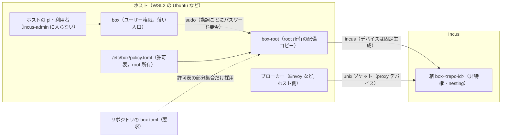

# 箱（Incus。試作名 `box`）

> 名前は暫定（`box`）。独立リポジトリへ切り出すときに変わる可能性がある。

リポジトリごとに 1 つの Incus のシステムコンテナ（以下「箱」）を作り、その中でエージェント（pi）を動かす仕組みの仕様。
**なぜこの方式か**は [ADR-0028](../../adr/0028-per-repo-agent-container.md) が決める。この文書は**どう動くか**（仕組み・使い方・信頼境界・限界）だけを書く。
実測の記録は [Incus の導入前調査](../../research/agents/incus-dev-environment.md)（§5・§6）。

実装は `scripts/box/`（本体）と `home/dot_local/bin/executable_box`（入口。`~/.local/bin/box` に配備）。
本体は標準ライブラリだけで書き、dotfiles 固有の部分（pi の配布物の生成）は `scripts/box/adapters/dotfiles/dist.py` に分けてある。

## 全体図



- `box` は引数を `box-root` へ渡すだけ。`box-root` は `sudo` 経由でだけ動き（`SUDO_UID` を呼び出し元として使う）、**許可表と box.toml から計画を毎回作り直す**。呼び出し側は動詞と repo id（`exec` は箱の中のコマンドも）しか渡せず、デバイス・Incus の設定は渡せない。
- `box-root` は `box setup` が `/usr/local/libexec/box/` へ複製した root 所有のコピーから実行する（作業ツリーのコードを root で実行しない）。コードを更新したら `box setup --update`。
- **許可表**（`/etc/box/policy.toml`）が権限の元。**box.toml** は箱の中から書き換えられるので、許可表の範囲の部分集合を選ぶ「要求」にすぎない。

## 信頼境界

守るもの:

- **箱の中のエージェントが、ホストの管理権限・秘密・許可表の外のパスへ届くこと**。箱は非特権（`security.privileged=false`）で、ホストのホームや Incus・Docker の管理ソケットは見えない。
- **ホストの pi が、Incus の管理権限を得ること**。利用者を `incus-admin` に入れない。入れると root 相当になる（実測: 制限つきプロジェクトでも、デバイス作成権限があれば `proxy` で管理ソケットを箱へ転送でき、完全に脱出できた。[§6](../../research/agents/incus-dev-environment.md)）。Incus の操作は `box-root` だけが行い、許可表から固定生成したデバイスしか付けない。
- 箱へ秘密を入れないこと（[認証](#認証)）。

守らないもの（対象外。ADR-0028 の脅威モデルに従う）:

- カーネル・GPU ドライバ・Incus・Docker の脆弱性による脱出。ホストを最新に保つ運用で対処する。
- 許可した範囲の中の操作の妥当性。リポジトリは rw、データは ro、認証は外部のスコープ（PAT・IAM）が決める範囲で使える。
- ホストの pi と箱の中の pi は**別物**。ホストの pi には `box` の許可された動詞だけを使わせ、`incus`・`box-root`・`box rm/register/setup` などはフルガードが拒否する（[フルガードの deny](#フルガードの-deny)）。これは「うっかり防止」で、境界ではない。境界は OS の権限（`incus-admin` に入らない・`box-root` の許可表）。
- **`NOPASSWD: ALL` の sudo 規則があると成立しない**。ホストの pi が `sudo incus` や `sudo` での任意の書き換えを通せる。WSL のディストロの既定のユーザーに入っていることがあり（実測。§6）、`box doctor` が検出して失敗にする。規則を外す（`/etc/sudoers.d/` の該当行）のは人の作業。

## コマンド

| コマンド | 説明 | パスワード |
| --- | --- | --- |
| `box setup [--dry-run] [--update]` | ホストの初期設定（Incus の導入と初期化・`subuid`/`subgid`・root 所有の配備コピー・許可表の雛形・sudoers・nat 用の `FORWARD` 許可）。`--update` は配備コピーの更新だけ。冪等 | 要（root で実行） |
| `box template` | テンプレートの作成（[テンプレート](#テンプレート)） | 要 |
| `box register [--data-root P] [--port N\|LO-HI] [--broker K] [--gpu] [--network M] [--proxy-upstream H:P] [--idmap user\|root] [--subnet CIDR]` | カレントの git のリポジトリを許可表へ登録する。追記の差分を表示し、端末で `y/N` を確認してから書く。リポジトリは呼び出し元の所有で、拒否リストに当たらないこと | 要 |
| `box up` | 箱を作って起動する（冪等。同名の別リポジトリの箱は拒否） | 不要 |
| `box stop` | 箱とブローカーを止める | 不要 |
| `box rm` | 箱を消す（ブローカーの後始末を含む） | 要 |
| `box snap [名前]` | スナップショットを取る | 要 |
| `box ls` | 呼び出し元の箱の一覧（`RUNNING`・`STOPPED`・`-`） | 不要 |
| `box pi [-- 引数]` | 箱の中で pi を起動する（作業ディレクトリはリポジトリ、ユーザーは許可表の uid） | 不要 |
| `box doctor` | 設定の点検（許可表・sudoers・`NOPASSWD: ALL`・box.toml・`core.hooksPath`・`extensions.worktreeConfig`。`incusbr0` の経路の点検は、`net.doctor_checks` があれば呼ぶ設計だが、現状の `net.py` には無い） | 不要 |
| `box selftest` | 箱の中からの否定試験（ホームの秘密・環境変数の秘密・`.git/hooks` と `.git/config` が書けない・proxy-only で直通できない） | 不要 |

- 動詞ごとの sudoers の規則は `scripts/box/root_helper.py` の `sudoers_snippet` が作る。パスワードが要る動詞は `timestamp_timeout=0`（直前の認証を使い回さない）。
- `--repo <id>` で対象を指定できる。省略時は、カレントの git のトップレベルを許可表の `path` と突き合わせて決める（`register` はディレクトリ名から id を作る）。
- 秘密を表示しない。`doctor`・`selftest` は環境変数の名前だけを出す。
- `box exec -- <コマンド>` で箱の中のコマンドを実行する（パスワードなし。`box pi` はこれで `pi` を起動する）。実行は箱のユーザー（uid・同じ gid）で行い、補助グループは持たない。

## 許可表と box.toml

### 許可表（`/etc/box/policy.toml`）

root 所有。ファイルと親ディレクトリがすべて root 所有で、グループ・他人から書けないことを毎回確かめる。未知のキー・型違いは拒否する。

```toml
[defaults]
network = "nat"                  # nat | proxy-only | offline
deny_paths = ["/mnt/c/Users"]    # 根の下でも拒否する追加のパス
template = "box-template"        # テンプレートのイメージの別名
build_proxy = "192.0.2.10:3128"  # テンプレート作成時だけ使う上流プロキシ（省略時は直接）

[repo.myrepo]                    # repo id: ^[a-z0-9][a-z0-9-]{0,30}$
path = "/home/alice/work/myrepo" # rw で重ねる唯一のパス
data_roots = ["/mnt/d/datasets"] # ro で渡してよい根
ports = [8080, [9000, 9099]]     # 公開してよいポート
brokers = ["gh", "copilot"]      # gh | copilot | aws | hf-cache
gpu = true
network = "proxy-only"
proxy_upstream = "192.0.2.10:3128"  # proxy-only のとき必須
idmap = "user"                   # user | root
uid = 1000                       # 1〜65535（0 は不可）
subnet = "10.77.0.0/24"          # incusbr0 のサブネットを固定

[repo.myrepo.secrets.gh]         # 秘密の出どころ（値は書かない）
source = "file"                  # file | command | prompt
path = "/etc/box/secret/gh"
```

### box.toml（リポジトリのルート。要求）

箱の中から書き換えられるので、**許可表の部分集合を選ぶだけ**。実パス・認証の取得方法・proxy の接続先・Incus の設定は書けない。

| キー | 意味 | 許可表との関係 |
| --- | --- | --- |
| `data` | 許可された根の下の相対パスの配列 | 根の下のディレクトリだけ。`..`・symlink・複数の根で曖昧・リポジトリと重なる・拒否リストに当たるものは拒否 |
| `ports` | 公開するポート | `ports` の範囲内。重複・ホストで使用中は拒否 |
| `brokers` | 使うブローカー | `brokers` の部分集合 |
| `gpu` | GPU | 許可表で `gpu = true` のときだけ |
| `network` | 外向き通信のモード | **より厳しい方向だけ**（`nat` < `proxy-only` < `offline`）。緩める要求は無視され、許可表の値になる |
| `images` | 貼り付け画像 | 未対応（`true` は拒否） |

未知のキー・64KiB 超・symlink の box.toml は拒否する。`up` 以外（`stop`・`rm` など）は、box.toml が壊れていても要求なしとして実行する。

## デバイス

デバイスは**呼び出し側が指定できず**、設定（BoxConfig）から固定生成する。生成後に `device_to_argv` が独立に再検査し（最後の関門）、許可外なら拒否する。

| 種類 | 条件 | 向き |
| --- | --- | --- |
| `disk` リポジトリ | 常に。ホストと同じ絶対パス | **rw** |
| `disk` `.git/hooks`・`.git/config` | 存在し symlink でないとき重ねる | **ro** |
| `disk` データ | box.toml の `data`（許可表の根の下） | ro |
| `disk` GPU のライブラリ | `gpu`。`/usr/lib/wsl/lib` と `/usr/lib/wsl/drivers`（別々に渡す） | ro |
| `unix-char` | `gpu`。`/dev/dxg` だけ | — |
| `proxy`（ホスト側で待ち受け） | `ports` ごと。`127.0.0.1:<port>` → 箱の `127.0.0.1:<port>` | — |
| `nic` | `nat` のとき。`incusbr0` に `eth0` | — |
| `proxy`（箱の中で待ち受け） | `proxy-only` の一般通信、ブローカー（`/var/lib/box-sock/<kind>.sock` か loopback の TCP） | — |

- `disk` の source は、拒否リスト（`/etc/box`・`/usr/local/libexec/box`・`/etc/sudoers*`・`/var/lib/incus`・`/var/lib/docker`・`/run`・`/var/run`・`/proc`・`/sys`・`/dev`、ホームの `.ssh`・`.gnupg`・`.aws`・`.azure`・`.config/gh`・`.config/box`・`.docker/config.json`・`.netrc`・`.git-credentials`・`.pi/agent/auth.json`・HF のトークン）と、`.sock` で終わるもの・管理ソケットへの経路を拒否する（実測: `/var/run/docker.sock` を重ねられた不具合を、このために直した。§6）。
- 箱は `security.nesting=true`・`security.privileged=false`・`raw.idmap`（`idmap = "user"` は `both <uid> <uid>`、`root` は箱の root をホストの uid に対応）。箱の中のユーザーは `ubuntu`（uid 1000）。
- ホスト側のブローカーのソケットは `/run/box-broker/<repo-id>/<kind>.sock`。箱の中は `/var/lib/box-sock/<kind>.sock`（`0660`・箱の uid のみ。`/run` は起動のたびに作り直され、proxy デバイスの listen が間に合わないため、イメージに持つ永続のディレクトリを使う）。

## 外向き通信

| モード | 箱の NIC | 一般通信 | 箱の中に見えるもの |
| --- | --- | --- | --- |
| `nat` | あり（`incusbr0`） | ホストの外へ NAT | 通常のネットワーク。ブローカー経由の認証もここで使う |
| `proxy-only` | **なし**（NIC の無い `box-nonet` プロファイル） | 箱の中の `0.0.0.0:3128` を proxy デバイスが上流プロキシ（許可表の `proxy_upstream`）へ中継するだけ | `127.0.0.1:3128` のプロキシ。`/etc/environment`・apt・docker.service・`/etc/gitconfig`・`/etc/profile.d/` に設定が入る。直通・DNS・IPv6 の経路は構造的に無い |
| `offline` | なし | なし | 外へ出る経路が無い |

- `proxy-only` でも、**compose のコンテナには**プロキシの環境変数を既定では渡さない（外へ出すサービスだけ compose の `environment` に明示する）。
- `offline` では、経路が `nat`／`proxy-only` のブローカーは**計画から外れる**（`gh`・`copilot`・`aws`・`hf-cache` は使えない）。
- `nat` のホスト側の準備: `incusbr0` の IPv6 を無効化、`subnet` があれば固定、別ディストロの Docker の `FORWARD drop` が `incusbr0` を止めるのを避ける許可を `DOCKER-USER` に入れる systemd ユニット（`box-forward.service`。コメント `incus-box` の規則だけを追加・削除する）。
- 上流プロキシの値は許可表だけに書く。コードには組織固有の値を持たない。制約のある環境（認証なしの上流プロキシだけが使える、など）が想定で、認証つきプロキシ・TLS 検査への対応は未検証。
- 経路の正本は `scripts/box/net.py` の経路表と各ブローカーの `Route`。`box up` は有効な経路を表示する。

## 認証

**箱には、本物の認証キー・`~/.ssh`・`~/.aws`・`~/.config/gh`・ホストの `GH_TOKEN` などを入れない**（拒否リストと `box selftest` が確かめる）。認証は、ホスト側の**ブローカー**が持ち、箱へはダミーと、ブローカーの在りかだけを渡す。

| 種類 | 箱の中 | ホスト側 | 経路 |
| --- | --- | --- | --- |
| `gh` | ダミーの `GH_TOKEN`、`gh` の設定（`http_unix_socket`） | Envoy が `api.github.com` だけを許し、`Authorization` を本物の PAT で差し替える | unix ソケット（`/var/lib/box-sock/gh.sock`）→ Envoy。`nat`・`proxy-only` |
| `copilot` | ダミーの `COPILOT_GITHUB_TOKEN`、`models.json` の `baseUrl`（`127.0.0.1:7112`） | Envoy が `POST /v1/messages`・`/responses`・`/chat/completions` だけを通す。長期トークンから短命トークンへ交換して差し替える | loopback → proxy デバイス → unix ソケット。`nat`・`proxy-only` |
| `aws` | `AWS_CONTAINER_CREDENTIALS_FULL_URI`（`127.0.0.1:7111`）。長期キー・`~/.aws` は無い | 認証情報サーバー（`broker/aws_server.py`）が、固定ロール・固定 TTL の `assume-role` の短期認証情報を `GET /creds` だけで返す。許可表の uid の権限で動く | loopback → proxy デバイス → unix ソケット。`nat`・`proxy-only` |
| `hf-cache` | `HF_HOME`（箱ごとの書き込み領域）とテレメトリ無効だけ。**トークンは無し** | なし | 公開モデルは一般通信で取得。ゲート付きは、ホストで取得して `data_roots` で ro に渡す |

- 秘密の出どころは許可表の `[repo.<id>.secrets.<名前>]`（`gh`・`copilot`・`aws-role`）。`file`（root か呼び出し元の所有・0600 相当・4096 バイト以下）・`command`（呼び出し元の権限・シェルなし・30 秒）・`prompt`（端末）。値は 1 行の ASCII のみ。
- 値は実行時にだけ解決し、`incus` の argv・計画の表示・ログに出さない。ホストでは root 専用の 0600 のファイルへ標準入力で書き、Envoy の SDS がそのファイルを参照する。
- ブローカーは systemd の一時 unit（`box-broker-<repo-id>-<kind>.service`）として常駐し、`box stop`・`box rm` で止めて状態ディレクトリを消す。再起動後の復活はしない（`box up` で起動し直す）。
- 防御は**外部のスコープ**（PAT の権限・IAM のロール）が担う。Envoy は通す先を絞るだけで、メソッドやパスの細かい制限は `copilot` だけ。`pis` 用ブローカーとの共通の考え方は[ブローカー](broker.md)。

## テンプレート

`box template` が、`images:ubuntu/24.04` から一時の箱 `box-template-build` を作り、初期設定をして `incus publish` する（別名は許可表の `template`。既定 `box-template`）。**`box up` はこのイメージから箱を作る**ので、初回に 1 度作る。

入るもの: docker.io・Node・npm・git・NVIDIA Container Toolkit・`ubuntu`（uid 1000）・`docker` グループ・`/etc/ld.so.conf.d/` の WSL のライブラリ・pi（ホストと同じ版。読めないときは警告して最新）。

- NVIDIA の鍵は、**指紋を確かめてから** keyring に置く（一致しなければ止める）。
- CDI の定義（`/etc/cdi/nvidia.yaml`）は、ドライバの更新でパスが変わるので、**箱の起動のたびに生成**する（`box-cdi.service`。`/dev/dxg` があるときだけ）。docker の `daemon.json` で CDI を有効にする。
- `build_proxy`（許可表）があれば、ビルド中だけ apt・git・curl・npm に設定し、公開前に消す（テンプレートには残さない）。
- pi の配布物: `box template` がユーザー権限で `~/.cache/box/dist`（0700。symlink は拒否）へ許可リスト方式で複製し（`adapters/dotfiles/dist.py`。拡張・prompts・skills・`AGENTS.md` など。認証・履歴・`.env`・`mcp.json`・`settings.json` などは入れない。秘密らしい内容があれば止める）、`box-root template --dist` がこれを**もう一度**検証してから `/opt/box-dist` へ置く（`distcheck.py`: 絶対パス・symlink なし・呼び出し元の所有・他人から書けない・通常ファイルとディレクトリだけ・ハードリンク拒否・件数と総サイズの上限・拒否名・秘密らしい内容）。
- 配布物を箱の中の pi がどう読むか（`~/.pi` への展開）は、このテンプレートでは行わない（`/opt/box-dist` へ置くだけ）。

## フルガードの deny

ホストのエージェントに箱の制御面を触らせない規則は `home/dot_config/agents/common.toml.tmpl` にあり、仕様と試験は[箱（Incus）の管理操作の拒否](../guard/agent-command-policy.md#箱incusの管理操作の拒否)。概要:

| 拒否するもの | 規則 |
| --- | --- |
| `incus`（読み取りの `list` も）、`box-root` の直接呼び出し | `[bash] deny` |
| 人だけが行う `box rm`・`box register`・`box setup` | `[bash] deny` |
| Incus・Docker のソケットへの接続 | `[[pi.guide]]` の `box-socket` |
| `/etc/box/`・`/usr/local/libexec/box/`・`/etc/sudoers*`・`/run/box-broker/` への書き込み | `[file] write_deny_globs`、`[[pi.guide]]` の `box-protected-write` |
| `incus-admin` グループへの追加 | `[[pi.guide]]` の `box-admin-group` |

- `box snap`・`box template` は deny に無い。パスワード必須（`sudo` が端末で尋ねる）で止まる。
- うっかり防止であり、別言語での書き込みや動的に組み立てたパスは検出できない。

## 検証状況

| 項目 | 状況 |
| --- | --- |
| Incus の導入、箱の外向き通信（`FORWARD` の対処）、GPU（`/dev/dxg`）、入れ子の Docker、箱からホストの `127.0.0.1` へ届かないこと、データの ro、git の重ね、複製の速度 | **実測済み**（[§5](../../research/agents/incus-dev-environment.md)。使い捨ての WSL ディストロ） |
| 制限つきプロジェクトでは足りないこと（デバイス作成権限は管理者権限と同じ） | **実測済み**（[§6 T10](../../research/agents/incus-dev-environment.md)） |
| `box setup`・`up`・`stop`・再 `up`・`ls`・権限モデル（`rm` はパスワード必須、`sudo incus` の拒否）・箱の中の確認（uid・所有者・ro・ホストのホームが見えない・GPU・nat の外向き通信）。`nat` のみ | **実測済み**（[§6 e2e](../../research/agents/incus-dev-environment.md)） |
| ブローカー（`gh`・`copilot`・`aws`・`hf-cache`）の実機での動作 | **未検証**（計画と設定の生成は単体試験のみ。Envoy の SDS の再読み込み、`aws` CLI の `FULL_URI`、Node の `fetch` の loopback など） |
| 実際の `box template`（docker・NVIDIA toolkit・CDI の導入） | **未検証** |
| 入れ子の Docker の GPU（CDI）を `box` のテンプレートで | **未検証**（素の箱での CDI は §5 で実測済み） |
| `proxy-only`・`offline` の実機での動作（NIC なし・プロキシ経由だけが通る・直通と DNS と IPv6 の遮断・プロキシ停止で止まる・`box.toml` は締める方向だけ） | **実測済み**（[§6 e2e](../../research/agents/incus-dev-environment.md#6-制限つきプロジェクトの実測t10と箱の結合試験e2e)。擬似プロキシ）。`box selftest` の実行は未検証 |
| 認証つきプロキシ・TLS 検査のある環境 | **未検証** |
| compose の GPU・再起動後の復帰（`raw.idmap`・`FORWARD` の許可のユニット）・長時間の安定 | **未検証** |
| Windows 側（PowerShell から使う運用など） | **未検証**（WSL の Ubuntu 内だけが対象） |

## 既知の限界と運用上の懸念

- **箱の中の root のコンテナのファイル所有者**: 入れ子の Docker のコンテナが root で動くと、リポジトリに作ったファイルがホストでは別の uid になり、ホストのユーザーが消せなくなることがある。compose に `user: "1000:1000"` を付けるか、`idmap = "root"` を使う。実物では未確認。
- **ディスクの重複**: ストレージが `dir`（WSL では overlay 上）なので、箱ごとに Docker のイメージが重複し、WSL の仮想ディスクは自動では縮まない。認証つきレジストリの認証は箱に入れない方針で、ホスト側にミラーを置く案は未実装。
- **更新への追従**: テンプレートの更新は、`box template` で作り直し、箱を作り直す（既存の箱は元のテンプレートのまま）。pi の版はテンプレート作成時の版に固定される。
- **サブネットの衝突**: `incusbr0`・`docker0`・compose のネットワークが、VPN などの経路とぶつかることがある。許可表の `subnet` で `incusbr0` を固定できる（`docker0` は対象外）。
- **再起動後の復帰**: WSL の再起動で箱は止まる。ブローカーは常駐しないので `box up` が必要。`FORWARD` の許可は systemd のユニットで入れ直す設計だが、再起動後の実測は無い。
- **CDI の再生成**: ドライバの更新後は、箱を起動し直すと再生成される（箱の中のユニット）。
- **署名**: コミットの署名鍵は箱に入れない。署名が要る運用ではホスト側でコミットする。
- **`--dist` の検証後の差し替え（TOCTOU）**: `box-root` が検証してから `incus file push` するまでに、呼び出し元が配布物を書き換えられる。配布物は呼び出し元が作る（元から呼び出し元の権限の範囲）ので、**許容**する。
- **`.git/hooks` の読み取り専用の限界**: `.git/hooks` と `.git/config` は ro で重ねるが、ホストの git の実行経路の一部しか守らない。`core.hooksPath`・`extensions.worktreeConfig`・作業ツリー内のスクリプト（`Makefile` やテストなど）は、箱が書いたコードがホストで実行されうる。`box doctor` が前 2 つを警告する。ホストでは、箱が書いたコードを自動で実行しない。
- **箱を捨てると失うもの**: 箱の中だけにあるもの（リポジトリ外のファイル、入れ子の Docker のイメージ・ボリューム、箱の中のユーザー設定）。リポジトリとデータはホストにあるので残る。必要ならスナップショット（`box snap`）を取る。
- **GPU の VRAM** は箱どうしで共有される（隔離されない）。CPU・メモリ・ディスクの上限は設定していない。
- **作業ツリー内の `.env`** などは、リポジトリが rw で見えるので箱から読める。`box.toml` の `data` や拒否リストは、リポジトリの中身には効かない。
- **Windows 側は未検証**。`box` は WSL2 の Ubuntu（または Linux）の中で使う。
