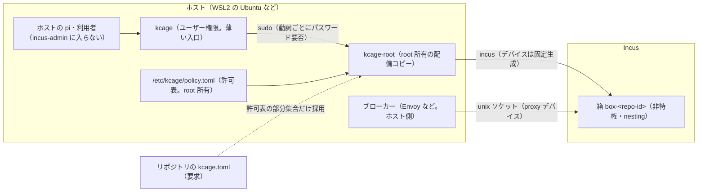

# 箱（Incus。試作名 `kcage`）

> 名前は暫定（`kcage`）。独立リポジトリへ切り出すときに変わる可能性がある。

リポジトリごとに 1 つの Incus のシステムコンテナ（以下「箱」）を作り、その中でエージェント（pi）を動かす仕組みの仕様。
**なぜこの方式か**は [ADR-0028](../../adr/0028-per-repo-agent-container.md) が決める。この文書は**どう動くか**（仕組み・使い方・信頼境界・限界）だけを書く。
実測の記録は [Incus の導入前調査](../../research/agents/incus-dev-environment.md)（§5・§6）。

実装は `scripts/kcage/`（本体）と `home/dot_local/bin/executable_kcage`（入口。`~/.local/bin/box` に配備）。
本体は標準ライブラリだけで書き、dotfiles 固有の部分（pi の配布物の生成）は `scripts/kcage/adapters/dotfiles/dist.py` に分けてある。

## 全体図



- `kcage` は引数を `kcage-root` へ渡すだけ。`kcage-root` は `sudo` 経由でだけ動き（`SUDO_UID` を呼び出し元として使う）、**許可表と kcage.toml から計画を毎回作り直す**。呼び出し側は動詞と repo id（`exec` は箱の中のコマンドも）しか渡せず、デバイス・Incus の設定は渡せない。
- `kcage-root` は `kcage setup` が `/usr/local/libexec/kcage/` へ複製した root 所有のコピーから実行する（作業ツリーのコードを root で実行しない）。コードを更新したら `kcage setup --update`。
- **許可表**（`/etc/kcage/policy.toml`）が権限の元。**kcage.toml** は箱の中から書き換えられるので、許可表の範囲の部分集合を選ぶ「要求」にすぎない。

## 信頼境界

守るもの:

- **箱の中のエージェントが、ホストの管理権限・秘密・許可表の外のパスへ届くこと**。箱は非特権（`security.privileged=false`）で、ホストのホームや Incus・Docker の管理ソケットは見えない。
- **ホストの pi が、Incus の管理権限を得ること**。利用者を `incus-admin` に入れない。入れると root 相当になる（実測: 制限つきプロジェクトでも、デバイス作成権限があれば `proxy` で管理ソケットを箱へ転送でき、完全に脱出できた。[§6](../../research/agents/incus-dev-environment.md)）。Incus の操作は `kcage-root` だけが行い、許可表から固定生成したデバイスしか付けない。
- 箱へ秘密を入れないこと（[認証](#認証)）。

守らないもの（対象外。ADR-0028 の脅威モデルに従う）:

- カーネル・GPU ドライバ・Incus・Docker の脆弱性による脱出。ホストを最新に保つ運用で対処する。
- WSL2 では、箱を抜けた場合の到達先（WSL の VM 全体・Windows 側の interop・共有されるネットワーク）が、箱の外にも広い。WSL2 は Microsoft が隔離境界とみなしていない（公開されている WSL の文書による。断定はせず、実機の挙動は未検証）。`kcage selftest` は、箱から `/mnt` のドライブ・`cmd.exe` 等・WSL の環境変数やソケットが見えないことを確かめる（[selftest](#コマンド)）。- 許可した範囲の中の操作の妥当性。リポジトリは rw、データは ro、認証は外部のスコープ（PAT・IAM）が決める範囲で使える。
- ホストの pi と箱の中の pi は**別物**。ホストの pi には `kcage` の許可された動詞だけを使わせ、`incus`・`kcage-root`・`kcage rm/register/setup` などはフルガードが拒否する（[フルガードの deny](#フルガードの-deny)）。これは「うっかり防止」で、境界ではない。境界は OS の権限（`incus-admin` に入らない・`kcage-root` の許可表）。
- **`NOPASSWD: ALL` の sudo 規則があると成立しない**。ホストの pi が `sudo incus` や `sudo` での任意の書き換えを通せる。WSL のディストロの既定のユーザーに入っていることがあり（実測。§6）、`kcage doctor` が検出して失敗にする。規則を外す（`/etc/sudoers.d/` の該当行）のは人の作業。

## コマンド

| コマンド | 説明 | パスワード |
| --- | --- | --- |
| `kcage setup [--dry-run] [--update]` | ホストの初期設定（Incus の導入と初期化・`subuid`/`subgid`・root 所有の配備コピー・許可表の雛形・sudoers・nat 用の `FORWARD` 許可）。`--update` は配備コピーの更新だけ。冪等 | 要（root で実行） |
| `kcage template` | テンプレートの作成（[テンプレート](#テンプレート)） | 要 |
| `kcage init [--dry-run]` | 初期化を 1 コマンドで行う: `kcage setup` → `kcage template` の順（setup が失敗したら template は実行しない）。`--dry-run` は setup の手順表示だけ。人だけが実行する | 要（root で実行） |
| `kcage uninstall [--dry-run] [--keep-policy] [--drop-subid] [--yes]` | 導入の巻き戻し。順序は setup の逆で冪等。箱（接頭辞 `kcage-` かつラベルあり。削除の直前にラベルを再確認）と `kcage-broker-*` のユニット・テンプレートの画像・`kcage-nonet`・`kcage-forward` と `DOCKER-USER` の規則（コメント `incus-kcage`）・`/etc/sudoers.d/kcage-<user>`・`/run/kcage-broker`・許可表 `/etc/kcage`（`--keep-policy` で残す）・最後に root 所有の配備コピー `/usr/local/libexec/kcage` を消す。`subuid`/`subgid` の行は既定で残し、`--drop-subid` のときだけ完全一致の行を消す。`--yes` が無ければ箱の一覧を見せて端末で `yes` を打たせる。人だけが実行する | 要（root で実行） |
| `kcage register [--data-root P] [--port N\|LO-HI] [--broker K] [--gpu] [--network M] [--proxy-upstream H:P] [--idmap user\|root] [--subnet CIDR] [--cpu N] [--memory SIZE] [--processes N] [--idmap-isolated]` | カレントの git のリポジトリを許可表へ登録する。追記の差分を表示し、端末で `y/N` を確認してから書く。リポジトリは呼び出し元の所有で、拒否リストに当たらないこと。`--cpu`・`--memory`・`--processes` は資源の上限（任意。形と範囲は [許可表](#許可表etckcagepolicytoml) と同じで、不正な形は拒否）。`--idmap-isolated` は未検証（[資源の上限](#資源の上限と-idmap-の分離任意)） | 要 |
| `kcage up` | 箱を作って起動する（冪等。同名の別リポジトリの箱は拒否） | 不要 |
| `kcage stop` | 箱とブローカーを止める | 不要 |
| `kcage rm` | 箱を消す（ブローカーの後始末を含む） | 要 |
| `kcage snap [名前]` | スナップショットを取る | 要 |
| `kcage ls` | 呼び出し元の箱の一覧（`RUNNING`・`STOPPED`・`-`） | 不要 |
| `kcage pi [-- 引数]` | 箱の中で pi を起動する（作業ディレクトリはリポジトリ、ユーザーは許可表の uid） | 不要 |
| `kcage doctor` | 設定の点検（許可表・sudoers・`NOPASSWD: ALL`・kcage.toml・`core.hooksPath`・`extensions.worktreeConfig`・`.git` の metadata（`commondir` など）。`incusbr0` の経路の点検は、`net.doctor_checks` があれば呼ぶ設計だが、現状の `net.py` には無い） | 不要 |
| `kcage selftest` | 箱の中からの否定試験（ホームの秘密・環境変数の秘密・`.git/hooks`・`.git/config`・`.git/commondir` が書けない・proxy-only で直通できない。root_helper 側では、WSL・Windows 側へ届かない確認も行う: `/mnt/?` に中身つきのドライブが無い・`cmd.exe`/`powershell.exe`/`wsl.exe` が PATH に無い・`WSL_INTEROP`/`WSL_DISTRO_NAME` が無く `/run/WSL` にソケットが無い。`/proc/sys/fs/binfmt_misc/WSLInterop` は、無い・`disabled` なら pass、それ以外は fail にせず警告を出す（カーネル全体の設定で、箱から見えるかは実機で未検証のため）） | 不要 |

- 動詞ごとの sudoers の規則は `scripts/kcage/root_helper.py` の `sudoers_snippet` が作る。パスワードが要る動詞は `timestamp_timeout=0`（直前の認証を使い回さない）。
- `--repo <id>` で対象を指定できる。省略時は、カレントの git のトップレベルを許可表の `path` と突き合わせて決める（`register` はディレクトリ名から id を作る）。
- 秘密を表示しない。`doctor`・`selftest` は環境変数の名前だけを出す。
- **導入の巻き戻しの範囲（`kcage uninstall`）**: root が消すのは `scripts/kcage/uninstall.py` の許可リスト（固定のパスと、形を検証した `kcage-<SUDO_USER>` の 1 ファイル）だけで、シンボリックリンクと root 所有でないものは拒否する。**Incus 本体（apt のパッケージ）・`incus-admin` グループ・`incus admin init` の結果は消さない**。終わりに手動で消す手順（`apt-get purge incus` など）を案内する。`kcage init` / `kcage uninstall` は実機（incus・root）での確認は未実施。
  - **実行元**: root で動かすのは root 所有の配備コピー（`/usr/local/libexec/kcage/kcage/uninstall.py`）だけで、このリポジトリのコードへは戻さない。cli（`sudo` の前）と `uninstall.py`（起動直後）は同じ検査（`scripts/kcage/trust.py`）で、**配備の根（`/usr/local/libexec/kcage` 全体。`kcage-root` の入口を含む）**と祖先が「root 所有・グループ/他人から書けない・途中にシンボリックリンクが無い」ことを確かめる。`uninstall.py` が import するモジュール（`trust.py`・`model.py`・`net.py`・`setup.py`・`plan.py`・`policy.py`・`config.py` など）が配備に無ければ、cli は `sudo` の前に「配備コピーが古い・欠けている。`kcage setup --update` で配備し直す」と案内する。満たさなければ `sudo` を呼ばず（`uninstall.py` は何もせず）終了コード 2。起動は `python3 -I -B`（環境変数・利用者の site を読まず、`__pycache__` を書かない）。
  - **事前検査（preflight）**: 破壊の前に、消すパスと実行する削除スクリプトが上の検査を満たすか、再帰削除する対象の中（と対象自身）にマウントポイント（bind mount を含む。`/proc/self/mountinfo` を bytes で読み、`\n` と ASCII の空白で分けて解析する。形の崩れたレコードは解析失敗として中止する）が無いか、Remove の種別（再帰でない対象は通常ファイル、再帰の対象はディレクトリ）が合うかを確かめる。1 つでも満たさなければ、`systemctl`・`incus` を含め何も実行せず終了コード 2（`--dry-run` でも結果を表示する）。実行の直前にも `realpath` とマウントを再検査する。
  - **状態の調査**: `incus`・`systemctl` の問い合わせが、成功（0）でも未導入（127）でもなく失敗したら、何も消さずに終了する。実行ファイルが無い（`FileNotFoundError`）ときだけ未導入として続行し、権限エラーなどで起動できないときは撤去を中止する。ブローカーの停止に失敗したら以降を実行しない。箱はラベルを削除の直前に再取得し、空なら全体を中止する。子プロセスの環境は `PATH` と `LANG` だけ（`INCUS_*` などを継承しない）。
  - **subuid/subgid を既定で残す理由**: setup が足した行か、利用者が自分で足した行かを区別できない（同じ `root:<uid>:1`）ため。`--drop-subid` のときだけ、完全一致の行を消す（指定が無ければ `/etc/subuid`・`/etc/subgid` は読みもしない）。そのとき対象は root 所有の通常ファイル・グループ/他人から書けない・FIFO やリンクでないことを確かめ、開いた fd（`O_NOFOLLOW`）で読み、置換の直前に再読込して変化があれば中止する。書き込みは全 bytes を書き切るまで繰り返し、書けなければ置換せず中止する。終わりの案内は、実行結果とフラグ（`--drop-subid`・`--keep-policy`）から作る。
  - **手順全体はトランザクションではない**: 途中で失敗したら、済んだ手順を表示して止まる（元には戻さない）。root 所有の配備コピーは最後に消すので、途中の失敗でも `kcage uninstall` を再実行できる。
  - **信頼の前提と既知の限界**: この道具が守るのは「利用者が書き換えられるコード・パスを root で実行・削除してしまうこと」。**root 所有の場所（`/etc`・`/usr/local/libexec`・`/etc/systemd/system`・`/proc`）は信頼する**。root がすでに侵害されている、または root 所有の領域に利用者所有のファイルが置かれている状況は対象外（その時点でホストは守れない）。次はこの前提と費用のつり合いからコードでは直していない。いずれも、疑わしいときは手動で確認してから実行する。
    - **配備の根の中に利用者所有のファイルがある**（root 所有ディレクトリの sibling に利用者所有の `tomllib.py` など）: 根全体は検査するが、検査の外の標準ライブラリ側の置き換えは防がない。対処: `ls -la /usr/local/libexec/kcage` で所有者を確かめ、疑わしければ `kcage setup --update`。
    - **systemd の drop-in・停止コマンド**（`/etc/systemd/system/*.d/` による `ExecStop` の差し替えなど）: root 所有の設定は信頼する。対処: `systemctl cat kcage-broker-*.service` で確かめる。
    - **他の管理ツールとの subuid/subgid の同時更新**は保護しない（自前の flock は足さない。置換前の再読込で検出できる範囲だけ中止する）。対処: `--drop-subid` はほかの管理ツールが動いていないときに実行する。
    - **同名で別ラベルの箱**: ラベルの有無で kcage の箱かを判断し、ラベルの値（同じ利用者か）までは区別しない。対処: `incus list` と `incus config get <箱> user.kcage.*` で確かめる。
    - **Incus の remote・project・alias**: 既定の remote・project だけを対象にする。ほかの project の `kcage-*` は消さない。対象の固定（`--project` の明示など）は使い捨て環境での確認が未実施。対処: `incus project list`・`incus remote list` を見る。
    - **TOCTOU（確認と実行の間の変化）**: preflight は確認の前に 1 回で、実行の直前には `realpath`・マウントだけを再検査する。再帰削除（`shutil.rmtree`）はマウントの越境を禁止していない（検査後に bind mount が作られると、その中も消える）。root 権限での bind mount の作成は対象外。
    - **画像は alias 名（`kcage-template`）で消す**: 同名の別物を区別しない。対処: `incus image alias list` で確かめる。
    - **規則の削除スクリプト**（`kcage-forward-del.sh`）は `nft` の問い合わせの失敗を成功として扱う。対処: 実行後に `sudo nft list ruleset | grep incus-kcage` で残りを確かめる。
    - **起動済みの子が返した rc=127**: 実行ファイルが無いときの 127 と区別できず未導入として扱う（`incus` の内部エラーでも続行しうる）。対処: 撤去後に `incus list` で残りを確かめる。
    - **未確認**: 実機の bind mount・ブローカーの停止 hook・Incus の対象固定は、使い捨て環境での確認が未実施。
- `kcage exec -- <コマンド>` で箱の中のコマンドを実行する（パスワードなし。`kcage pi` はこれで `pi` を起動する）。実行は箱のユーザー（uid・同じ gid）で行い、補助グループは持たない。

## 許可表と kcage.toml

### 許可表（`/etc/kcage/policy.toml`）

root 所有。ファイルと親ディレクトリがすべて root 所有で、グループ・他人から書けないことを毎回確かめる。未知のキー・型違いは拒否する。

```toml
[defaults]
network = "nat"                  # nat | proxy-only | offline
deny_paths = ["/mnt/c/Users"]    # 根の下でも拒否する追加のパス
template = "kcage-template"        # テンプレートのイメージの別名
build_proxy = "192.0.2.10:3128"  # テンプレート作成時だけ使う上流プロキシ（省略時は直接）

[repo.myrepo]                    # repo id: ^[a-z0-9][a-z0-9-]{0,30}$
path = "/home/alice/work/myrepo" # rw で重ねる唯一のパス
data_roots = ["/mnt/d/datasets"] # ro で渡してよい根
ports = [8080, [9000, 9099]]     # 公開してよいポート
brokers = ["gh", "copilot"]      # gh | copilot | aws | hf-cache
gpu = true
network = "proxy-only"
proxy_upstream = "192.0.2.10:3128"  # proxy-only のとき必須
idmap = "user"                   # user | root
uid = 1000                       # 1〜65535（0 は不可）
gid = 1000                       # 1〜65535（省略時は uid。register は SUDO_GID を書く）
subnet = "10.77.0.0/24"          # incusbr0 のサブネットを固定
cpu = 4                          # 任意。1〜1024（省略は上限なし）
memory = "8GiB"                  # 任意。<整数>MiB / GiB、128MiB〜1024GiB
processes = 4096                 # 任意。64〜4194304
idmap_isolated = false           # 任意。既定 false（未検証。下記）

[repo.myrepo.secrets.gh]         # 秘密の出どころ（値は書かない）
source = "file"                  # file | command | prompt
path = "/etc/kcage/secret/gh"
```

### 資源の上限と idmap の分離（任意）

- `cpu`・`memory`・`processes` は、箱の**新規作成時**（`kcage up` の `incus init`）に `limits.cpu`・`limits.memory`・`limits.processes` として渡す。未設定なら従来どおり上限なし。値は整数・単位の形を `fullmatch` で検証し、`incus init` へは `-c key=value` の 1 引数（argv のリスト）で渡す。既存の箱へは反映されない（`kcage rm` → `up` で作り直す）。ディスクの上限は `dir` ストレージでは設定できない。
- kcage.toml の `cpu`・`memory`・`processes` は、許可表の値より**小さい値にだけ**効く（大きい要求は許可表の値に切り詰める。許可表が未設定なら要求は無視する）。
- `kcage doctor` は上限の有無を表示するだけ（fail にしない）。
- `idmap_isolated = true` は `security.idmap.isolated=true` を渡す。**未検証。`raw.idmap` との併用と `/etc/subuid` の範囲の関係は実機で確かめていない。実機で `kcage up` と `kcage selftest` が通ることを確かめてから使う。**
- 反映には、配備コピーの更新（`kcage setup --update`）が要る（`kcage-root` は配備コピーから動くため）。

### kcage.toml（リポジトリのルート。要求）

箱の中から書き換えられるので、**許可表の部分集合を選ぶだけ**。実パス・認証の取得方法・proxy の接続先・Incus の設定は書けない。

| キー | 意味 | 許可表との関係 |
| --- | --- | --- |
| `data` | 許可された根の下の相対パスの配列 | 根の下のディレクトリだけ。`..`・symlink・複数の根で曖昧・リポジトリと重なる・拒否リストに当たるものは拒否 |
| `ports` | 公開するポート | `ports` の範囲内。重複・ホストで使用中は拒否 |
| `brokers` | 使うブローカー | `brokers` の部分集合 |
| `gpu` | GPU | 許可表で `gpu = true` のときだけ |
| `network` | 外向き通信のモード | **より厳しい方向だけ**（`nat` < `proxy-only` < `offline`）。緩める要求は無視され、許可表の値になる |
| `images` | 貼り付け画像 | 未対応（`true` は拒否） |
| `cpu`・`memory`・`processes` | 資源の上限 | **許可表の値より小さいときだけ**効く。許可表が未設定なら無視 |

未知のキー・64KiB 超・symlink の kcage.toml は拒否する。`up` 以外（`stop`・`rm` など）は、kcage.toml が壊れていても要求なしとして実行する。

## デバイス

デバイスは**呼び出し側が指定できず**、設定（BoxConfig）から固定生成する。生成後に `device_to_argv` が独立に再検査し（最後の関門）、許可外なら拒否する。

| 種類 | 条件 | 向き |
| --- | --- | --- |
| `disk` リポジトリ | 常に。ホストと同じ絶対パス | **rw** |
| `disk` `.git` の pin | `.git` が実ディレクトリ（symlink でない）のとき、自分自身へ重ねる（下の「`.git` の差し替え」）。ro の子より前 | **rw** |
| `disk` `.git/hooks`・`.git/config`・`.git/commondir` | 存在し symlink でないとき重ねる（`commondir` は up が先に用意する。既知の限界を参照） | **ro** |
| `disk` データ | kcage.toml の `data`（許可表の根の下） | ro |
| `disk` GPU のライブラリ | `gpu`。`/usr/lib/wsl/lib` と `/usr/lib/wsl/drivers`（別々に渡す） | ro |
| `unix-char` | `gpu`。`/dev/dxg` だけ | — |
| `proxy`（ホスト側で待ち受け） | `ports` ごと。`127.0.0.1:<port>` → 箱の `127.0.0.1:<port>` | — |
| `nic` | `nat` のとき。`incusbr0` に `eth0` | — |
| `proxy`（箱の中で待ち受け） | `proxy-only` の一般通信、ブローカー（`/var/lib/kcage-sock/<kind>.sock` か loopback の TCP） | — |

- `disk` の source は、拒否リスト（`/etc/kcage`・`/usr/local/libexec/kcage`・`/etc/sudoers*`・`/var/lib/incus`・`/var/lib/docker`・`/run`・`/var/run`・`/proc`・`/sys`・`/dev`、ホームの `.ssh`・`.gnupg`・`.aws`・`.azure`・`.config/gh`・`.config/kcage`・`.docker/config.json`・`.netrc`・`.git-credentials`・`.pi/agent/auth.json`・HF のトークン）と、`.sock` で終わるもの・管理ソケットへの経路を拒否する（実測: `/var/run/docker.sock` を重ねられた不具合を、このために直した。§6）。
- 箱は `security.nesting=true`・`security.privileged=false`・`raw.idmap`（`idmap = "user"` は `uid <uid> <uid>` と `gid <gid> <uid>`、`root` は箱の root をホストの uid・gid に対応）。箱の中のユーザーは `ubuntu`（uid・gid とも 1000）。ホストの gid は許可表の `gid`（省略時は uid。`kcage register` は呼び出し元の `SUDO_GID` を書く）。`kcage setup` は `/etc/subuid` に `root:<uid>:1`、`/etc/subgid` に `root:<gid>:1` を足す。
- ホスト側のブローカーのソケットは `/run/kcage-broker/<repo-id>/<kind>.sock`。箱の中は `/var/lib/kcage-sock/<kind>.sock`（`0660`・箱の uid のみ。`/run` は起動のたびに作り直され、proxy デバイスの listen が間に合わないため、イメージに持つ永続のディレクトリを使う）。

## 外向き通信

| モード | 箱の NIC | 一般通信 | 箱の中に見えるもの |
| --- | --- | --- | --- |
| `nat` | あり（`incusbr0`） | ホストの外へ NAT | 通常のネットワーク。ブローカー経由の認証もここで使う |
| `proxy-only` | **なし**（NIC の無い `kcage-nonet` プロファイル） | 箱の中の `0.0.0.0:3128` を proxy デバイスが上流プロキシ（許可表の `proxy_upstream`）へ中継するだけ | `127.0.0.1:3128` のプロキシ。`/etc/environment`・apt・docker.service・`/etc/gitconfig`・`/etc/profile.d/` に設定が入る。直通・DNS・IPv6 の経路は構造的に無い |
| `offline` | なし | なし | 外へ出る経路が無い |

- `proxy-only` でも、**compose のコンテナには**プロキシの環境変数を既定では渡さない（外へ出すサービスだけ compose の `environment` に明示する）。
- `offline` では、経路が `nat`／`proxy-only` のブローカーは**計画から外れる**（`gh`・`copilot`・`aws`・`hf-cache` は使えない）。
- `nat` のホスト側の準備: `incusbr0` の IPv6 を無効化、`subnet` があれば固定、別ディストロの Docker の `FORWARD drop` が `incusbr0` を止めるのを避ける許可を `DOCKER-USER` に入れる systemd ユニット（`kcage-forward.service`。コメント `incus-kcage` の規則だけを追加・削除する）。
- 上流プロキシの値は許可表だけに書く。コードには組織固有の値を持たない。制約のある環境（認証なしの上流プロキシだけが使える、など）が想定で、認証つきプロキシ・TLS 検査への対応は未検証。
- 経路の正本は `scripts/kcage/net.py` の経路表と各ブローカーの `Route`。`kcage up` は有効な経路を表示する。

## 認証

**箱には、本物の認証キー・`~/.ssh`・`~/.aws`・`~/.config/gh`・ホストの `GH_TOKEN` などを入れない**（拒否リストと `kcage selftest` が確かめる）。認証は、ホスト側の**ブローカー**が持ち、箱へはダミーと、ブローカーの在りかだけを渡す。

| 種類 | 箱の中 | ホスト側 | 経路 |
| --- | --- | --- | --- |
| `gh` | ダミーの `GH_TOKEN`、`gh` の設定（`http_unix_socket`） | Envoy が `api.github.com` だけを許し、`Authorization` を本物の PAT で差し替える | unix ソケット（`/var/lib/kcage-sock/gh.sock`）→ Envoy。`nat`・`proxy-only` |
| `copilot` | ダミーの `COPILOT_GITHUB_TOKEN`、`models.json` の `baseUrl`（`127.0.0.1:7112`） | Envoy が `POST /v1/messages`・`/responses`・`/chat/completions` だけを通す。長期トークンから短命トークンへ交換して差し替える | loopback → proxy デバイス → unix ソケット。`nat`・`proxy-only` |
| `aws` | `AWS_CONTAINER_CREDENTIALS_FULL_URI`（`127.0.0.1:7111`）。長期キー・`~/.aws` は無い | 認証情報サーバー（`broker/aws_server.py`）が、固定ロール・固定 TTL の `assume-role` の短期認証情報を `GET /creds` だけで返す。許可表の uid の権限で動く | loopback → proxy デバイス → unix ソケット。`nat`・`proxy-only` |
| `hf-cache` | `HF_HOME`（箱ごとの書き込み領域）とテレメトリ無効だけ。**トークンは無し** | なし | 公開モデルは一般通信で取得。ゲート付きは、ホストで取得して `data_roots` で ro に渡す |

- 秘密の出どころは許可表の `[repo.<id>.secrets.<名前>]`（`gh`・`copilot`・`aws-role`）。`file`（root か呼び出し元の所有・0600 相当・4096 バイト以下）・`command`（呼び出し元の権限・シェルなし・30 秒）・`prompt`（端末）。値は 1 行の ASCII のみ。
- 値は実行時にだけ解決し、`incus` の argv・計画の表示・ログに出さない。ホストでは root 専用の 0600 のファイルへ標準入力で書き、Envoy の SDS がそのファイルを参照する。
- ブローカーは systemd の一時 unit（`kcage-broker-<repo-id>-<kind>.service`）として常駐し、`kcage stop`・`kcage rm` で止めて状態ディレクトリを消す。再起動後の復活はしない（`kcage up` で起動し直す）。
- 防御は**外部のスコープ**（PAT の権限・IAM のロール）が担う。Envoy は通す先を絞るだけで、メソッドやパスの細かい制限は `copilot` だけ。`pis` 用ブローカーとの共通の考え方は[ブローカー](broker.md)。

## テンプレート

`kcage template` が、`images:ubuntu/24.04` から一時の箱 `kcage-template-build` を作り、初期設定をして `incus publish` する（別名は許可表の `template`。既定 `kcage-template`）。**`kcage up` はこのイメージから箱を作る**ので、初回に 1 度作る。

入るもの: docker.io・Node・npm・git・NVIDIA Container Toolkit・`ubuntu`（uid 1000）・`docker` グループ・`/etc/ld.so.conf.d/` の WSL のライブラリ・pi（ホストと同じ版。読めないときは警告して最新）。

- NVIDIA の鍵は、**指紋を確かめてから** keyring に置く（一致しなければ止める）。
- CDI の定義（`/etc/cdi/nvidia.yaml`）は、ドライバの更新でパスが変わるので、**箱の起動のたびに生成**する（`kcage-cdi.service`。`/dev/dxg` があるときだけ）。docker の `daemon.json` で CDI を有効にする。
- `build_proxy`（許可表）があれば、ビルド中だけ apt・git・curl・npm に設定し、公開前に消す（テンプレートには残さない）。
- pi の配布物: `kcage template` がユーザー権限で `~/.cache/kcage/dist`（0700。symlink は拒否）へ許可リスト方式で複製し（`adapters/dotfiles/dist.py`。拡張・prompts・skills・`AGENTS.md` など。認証・履歴・`.env`・`mcp.json`・`settings.json` などは入れない。秘密らしい内容があれば止める）、`kcage-root template --dist` がこれを**もう一度**検証してから `/opt/kcage-dist` へ置く（`distcheck.py`: 絶対パス・symlink なし・呼び出し元の所有・他人から書けない・通常ファイルとディレクトリだけ・ハードリンク拒否・件数と総サイズの上限・拒否名・秘密らしい内容）。
- 配布物を箱の中の pi がどう読むか（起動スクリプトによる配線）は、次の[箱の中のフルガード](#箱の中のフルガード)。テンプレートは `/opt/kcage-dist` へ置くだけで、`~/.pi` へは展開しない。

## 箱の中のフルガード

箱の pi にも、ホストと同じフルガード（判定器 `~/.config/pi/harness`）を持ち込む（第 1 段。最小の変更）。

構成:

- 配布物に、**root 所有の起動スクリプト `/opt/kcage-dist/bin/kcage-pi`** を入れる（`dist.py` の `build_box_dist` が生成する）。`kcage pi` はこれを実行する。中身は `pis` の `BASE_FLAGS` と同じ `--no-approve -nbt -ne -e builtin:mcp` に、自作拡張と判定器を絶対パスの `-e` で足したもの。settings.json の `extensions` には頼らない（読めなかったときに組み込みツールだけが残る fail-open を避ける）。判定器が無ければ起動しない。
- **箱用の `rules.json`** は、`scripts/agents/generate.py --target pi-harness` を `HOME=/home/ubuntu`・局所設定なし・ホストの描画済み `common.toml` で呼んで作る。ホスト用の `rules.json`（と `*.e2e-bak`）は複製しない。ホストの方針の生成物は変えず、`dist.py` の overlay で次を直す。
  - `post_edit`・`mcp` を空にする（箱に整形スクリプトと `uv` が無い）。
  - 役割のツールから `pr_summary`・`work` を外す（箱では PR ビューアと台帳に繋がらない）。
  - `write_deny_globs` に `/opt/kcage-dist/**`・`~/.pi/agent/models.json`・`~/.pi/agent/auth.json` を足し、`external_read` に `/opt/kcage-dist` を足す。
  - ホストのホームのパスが残ったら配布物を作らない。生成物も含めて秘密を走査する。
- 起動スクリプトは `PI_HARNESS_BYPASS=1` を渡す。**ask は許可に落ち、deny と必須確認（`[pi.confirm]`・`[pi.integrate]`）は残る**。境界の証明（canary）は Incus 用には作っていない。ask のまま使うには、`dist.py` の `BOX_ENV` を変えてテンプレートを作り直す。
- テンプレートは `ripgrep`・`fd-find` を入れ（pi が GitHub から取得しなくて済む）、`/home/ubuntu/.pi/agent` を uid 1000 所有で作る（pi が lock・認証・セッションを書く）。
- **既存の箱への反映**: `kcage template` でテンプレートを作り直し、箱も作り直す（`kcage rm` → `kcage up`）。

既知の限界（うっかり防止であり、敵対的な迂回への防御ではない）:

- **`kcage exec -- pi` は無ガード**（起動スクリプトを通らない）。`kcage pi` を使う。
- 箱のユーザーは `docker` グループなので、`docker run -v /opt/kcage-dist:/m` で配布物を書き換えられる。root 所有でも防げない（許容して記録）。
- 箱の AI は、bash から素の `pi -ne` を起動できる（ホストと同じ。判定器に該当の規則が無い）。
- project trust: `--no-approve` で作業先の `.pi/` は読まない。ただし起動スクリプトを通らない `pi` は、信頼されると `.pi/extensions` をガード外で読みうる。
- 判定器が読めない場合の fail-open は、起動スクリプトの存在確認で防ぐ。pi 側が別の理由で拡張を落とす場合は未確認。
- 実機（Incus の箱の中の pi）での動作は未検証。

## フルガードの deny

ホストのエージェントに箱の制御面を触らせない規則は `home/dot_config/agents/common.toml.tmpl` にあり、仕様と試験は[箱（Incus）の管理操作の拒否](../guard/agent-command-policy.md#箱incusの管理操作の拒否)。概要:

| 拒否するもの | 規則 |
| --- | --- |
| `incus`（読み取りの `list` も）、`kcage-root` の直接呼び出し | `[bash] deny` |
| 人だけが行う `kcage rm`・`kcage register`・`kcage setup`・`kcage init`・`kcage uninstall` | `[bash] deny` |
| Incus・Docker のソケットへの接続 | `[[pi.guide]]` の `kcage-socket` |
| `/etc/kcage/`・`/usr/local/libexec/kcage/`・`/etc/sudoers*`・`/run/kcage-broker/` への書き込み | `[file] write_deny_globs`、`[[pi.guide]]` の `kcage-protected-write` |
| `incus-admin` グループへの追加 | `[[pi.guide]]` の `kcage-admin-group` |

- `kcage snap`・`kcage template` は deny に無い。パスワード必須（`sudo` が端末で尋ねる）で止まる。
- うっかり防止であり、別言語での書き込みや動的に組み立てたパスは検出できない。

## 検証状況

| 項目 | 状況 |
| --- | --- |
| Incus の導入、箱の外向き通信（`FORWARD` の対処）、GPU（`/dev/dxg`）、入れ子の Docker、箱からホストの `127.0.0.1` へ届かないこと、データの ro、git の重ね、複製の速度 | **実測済み**（[§5](../../research/agents/incus-dev-environment.md)。使い捨ての WSL ディストロ） |
| 制限つきプロジェクトでは足りないこと（デバイス作成権限は管理者権限と同じ） | **実測済み**（[§6 T10](../../research/agents/incus-dev-environment.md)） |
| `kcage setup`・`up`・`stop`・再 `up`・`ls`・権限モデル（`rm` はパスワード必須、`sudo incus` の拒否）・箱の中の確認（uid・所有者・ro・ホストのホームが見えない・GPU・nat の外向き通信）。`nat` のみ | **実測済み**（[§6 e2e](../../research/agents/incus-dev-environment.md)） |
| `gh` ブローカー・`copilot` ブローカー（ダミーの認証での起動の失敗）・`kcage selftest`・`kcage doctor` | **実測済み**（[§6 e2e 第 4〜6 段](../../research/agents/incus-dev-environment.md#6-制限つきプロジェクトの実測t10と箱の結合試験e2e)） |
| ブローカー `aws`・`hf-cache`、`copilot` の本物のトークンでの動作 | **未検証**（計画と設定の生成は単体試験のみ。Envoy の SDS の再読み込み、`aws` CLI の `FULL_URI`、Node の `fetch` の loopback など） |
| 実際の `kcage template`（docker・compose・NVIDIA toolkit・CDI・Node・pi） | **実測済み**（同上） |
| 入れ子の Docker と GPU（CDI）・compose の GPU 予約・再起動後の CDI | **実測済み**（同上） |
| `proxy-only`・`offline` の実機での動作（NIC なし・プロキシ経由だけが通る・直通と DNS と IPv6 の遮断・プロキシ停止で止まる・`kcage.toml` は締める方向だけ） | **実測済み**（[§6 e2e](../../research/agents/incus-dev-environment.md#6-制限つきプロジェクトの実測t10と箱の結合試験e2e)。擬似プロキシ）。`kcage selftest` の実行は未検証 |
| 認証つきプロキシ・TLS 検査のある環境 | **未検証** |
| 再起動後の復帰（`raw.idmap`・`FORWARD` の許可のユニット）・長時間の安定 | **未検証** |
| Windows 側（PowerShell から使う運用など） | **未検証**（WSL の Ubuntu 内だけが対象） |

## 既知の限界と運用上の懸念

- **ホストの gid が uid と違う機**: 許可表の `gid` で対応させる（旧版は gid = uid を仮定し、リポジトリのファイルのグループがホストでは別のグループになった）。既存の許可表・箱は、`gid` を足して `kcage setup` を実行し、箱を作り直すまで旧い対応のまま。
- **箱の中の root のコンテナのファイル所有者**: 入れ子の Docker のコンテナが root で動くと、リポジトリに作ったファイルがホストでは別の uid になり、ホストのユーザーが消せなくなることがある。compose に `user: "1000:1000"` を付けるか、`idmap = "root"` を使う。実物では未確認。
- **ディスクの重複**: ストレージが `dir`（WSL では overlay 上）なので、箱ごとに Docker のイメージが重複し、WSL の仮想ディスクは自動では縮まない。認証つきレジストリの認証は箱に入れない方針で、ホスト側にミラーを置く案は未実装。
- **更新への追従**: テンプレートの更新は、`kcage template` で作り直し、箱を作り直す（既存の箱は元のテンプレートのまま）。pi の版はテンプレート作成時の版に固定される。
- **サブネットの衝突**: `incusbr0`・`docker0`・compose のネットワークが、VPN などの経路とぶつかることがある。許可表の `subnet` で `incusbr0` を固定できる（`docker0` は対象外）。
- **再起動後の復帰**: WSL の再起動で箱は止まる。ブローカーは常駐しないので `kcage up` が必要。`FORWARD` の許可は systemd のユニットで入れ直す設計だが、再起動後の実測は無い。
- **CDI の再生成**: ドライバの更新後は、箱を起動し直すと再生成される（箱の中のユニット）。
- **署名**: コミットの署名鍵は箱に入れない。署名が要る運用ではホスト側でコミットする。
- **`--dist` の検証後の差し替え（TOCTOU）**: `kcage-root` が検証してから `incus file push` するまでに、呼び出し元が配布物を書き換えられる。配布物は呼び出し元が作る（元から呼び出し元の権限の範囲）ので、**許容**する。
- **`.git/hooks` の読み取り専用の限界**: `.git/hooks`・`.git/config`・`.git/commondir` は ro で重ねるが、ホストの git の実行経路の一部しか守らない。`core.hooksPath`・`extensions.worktreeConfig`・作業ツリー内のスクリプト（`Makefile` やテストなど）は、箱が書いたコードがホストで実行されうる。`kcage doctor` が前 2 つを警告する。ホストでは、箱が書いたコードを自動で実行しない。
- **`.git/commondir` の迂回（封じ済み）**: `.git/commondir` に別のディレクトリを書くと、git はそこから config・hooks を読むため、箱が書ける作業ツリー内を指されると `hooks`・`config` の ro を迂回できる。`kcage up`（kcage-root）が、メインの `.git`（実ディレクトリ）に中身 `.` の `commondir` を、無ければ作り、有って無害（`.` または `.git` 自身）なら何もせず、それ以外なら up を拒否する。作成は呼び出し元の uid・gid へ権限を落として `O_CREAT|O_EXCL|O_NOFOLLOW` で行い（root が書くのはこの 1 ファイルだけ）、戻せなければ異常終了する。そのうえで `commondir` を ro で重ねる。この対策の前に作った箱は `commondir` が書けるので、`selftest` が fail する。`kcage rm` のあと `up` し直す。
- **`.git` の差し替え（`mv .git`）の迂回（封じ済み）**: リポジトリを rw で重ね、その中の `.git/hooks`・`.git/config`・`.git/commondir` だけを ro で重ねるだけだと、`.git` ディレクトリ自体はマウントポイントでないので、箱の中の一般ユーザーが `mv .git .git.old` でき、書き込み可能な `.git` を作り直せる（ro の重ねは移動した側に付いたまま）。ホストの git は新しい `.git/config`（例 `core.fsmonitor`）と `.git/hooks` を読むので、箱から脱出できる（bubblewrap の mount namespace で再現済み）。対策は、`.git` を**自分自身へ rw で bind（pin）してから**子の ro の重ねを付けること（`config.resolve` が ro の前に足す。`device_to_argv` は source と path が同じ rw の disk を、拒否リスト・ソケットの検査を通した上で許す）。pin 済みの `.git` は `mv`・`rm -rf` が EBUSY で失敗し、ro の重ねは保たれ、objects・HEAD などの通常の書き込みはできる（bubblewrap で確認済み）。`.git` が実ディレクトリでない（linked worktree・symlink）ときは適用されない（hooks・config と同じ扱い）。`selftest` が、`.git` がマウントポイントであることと、`mv .git` が失敗すること（成功したら元へ戻して fail）を調べ、`doctor` も pin の有無を fail で報告する。この対策の前に作った箱は pin が無いので、`kcage setup --update`（配備コピーの更新）のあと `kcage rm` → `kcage up` で作り直す。
  - **未検証**: Incus が disk デバイスを path の浅い順（親が先）にマウントするか、pin が Incus の箱で実際に効くかは実機で未確認（デバイス名は `m-repo-<連番>` で、親を先に足している）。
  - **未検証の推測（断定しない）**: 箱の中のユーザーは `docker` グループに入っており、入れ子の Docker で箱の root 相当になれる。root 相当は自分のマウント名前空間で ro・pin の重ねを外せる（`umount`）可能性があり、その場合は `.git/config` などの基になるファイルへ書ける。ro・pin の重ねは、箱の root 相当に対する境界ではないかもしれない（未検証。実機で確かめる）。公開されている同種の OSS（coi）も、bind mount の ro は root で外せると述べ、ホスト側の `chattr +i` を併用している。
- **共有の `.git` に残る信頼の前提**: refs・objects・index・`info/`・`modules/` などは箱から変更できる（箱は develop の ref も動かせる。worktree の約束は process の統制で、機械の強制ではない）。ホストで commit・merge などの git を動かす前に `kcage doctor` を実行する。`doctor` は `commondir` の不審な値（fail）と、`config.worktree`・`info/attributes`・`objects/info/alternates`・`remotes/`・`branches/`・`modules/`（warn）を調べる。`.git` が実ディレクトリでない（linked worktree・symlink）リポジトリには、commondir の封じ込めは適用されない（hooks・config と同じ扱い）。
- **箱を捨てると失うもの**: 箱の中だけにあるもの（リポジトリ外のファイル、入れ子の Docker のイメージ・ボリューム、箱の中のユーザー設定）。リポジトリとデータはホストにあるので残る。必要ならスナップショット（`kcage snap`）を取る。
- **GPU の VRAM** は箱どうしで共有される（隔離されない）。CPU・メモリ・プロセス数の上限は任意（許可表の `cpu`・`memory`・`processes`。既定は上限なし）。ディスクの上限は `dir` ストレージでは不可。
- **作業ツリー内の `.env`** などは、リポジトリが rw で見えるので箱から読める。`kcage.toml` の `data` や拒否リストは、リポジトリの中身には効かない。
- **Windows 側は未検証**。`kcage` は WSL2 の Ubuntu（または Linux）の中で使う。

### 箱に入れないもの（人向けの設定）と、その理由

- 箱は AI の作業台で、人は `kcage pi` の画面とホスト側のエディタから使う。シェル・端末・エディタの設定（`.bashrc`・`.tmux.conf`・`.vimrc` など）と、他の AI ツールの設定は入れない。
- 箱の中で `chezmoi apply` はしない。dotfiles には無 sudo・無秘密のモード（`CHEZMOI_NO_SUDO=1`・`--skip-secrets`）があり、秘密と sudo の問題は避けられる。それでも個別の配布物（許可リスト）を選ぶ理由は、ガードのコードと方針を root 所有の `/opt/kcage-dist` に置けること、ホストの方針を箱用に描画するための分岐をテンプレートへ足さずに済むこと（箱用の調整は生成した `rules.json` への overlay で行う）、展開された `~/.pi/agent/settings.json` がホスト版の方針を読み込んで起動スクリプトと矛盾しないこと、外部取得（`.chezmoiexternal`）を走らせないこと。
- 人向けの快適さが要るようになったら、無害な項目だけを対象に限定して `CHEZMOI_NO_SUDO=1 chezmoi apply --skip-secrets --exclude=scripts` を実行する案がある（pi 関連と他の AI ツール関連は対象外にする）。
- git のコミット者情報（`user.name`・`user.email`）は、ホストの実効の git 設定（リポジトリごと）から `kcage up` が読み取って箱へ渡し、箱の `~/.config/git/config` に生成する（利用者の追加の操作は無し。実装中）。ホストの設定は `~/.config/git/config` と、そこから `include` される `~/.config/git/user`（個人の機だけ・秘密由来）にあり、`~/.gitconfig` はほぼ空なので、`~/.gitconfig` だけを読み取り専用で重ねても入らない。XDG の 2 ファイルを重ねると credential helper や `include` のホスト前提まで持ち込むので、必要な値だけを渡す。

### 同じ WSL に複数のディストロがあるときの注意

- WSL2 のネットワークは、ディストロ間で共有される。主ディストロで Incus（`incusbr0`）を導入済みの間に、別のディストロで Incus を初期化すると、後者の箱が主ディストロのブリッジに繋がって通信できなくなる（実測: `Network is unreachable`）。使い捨てのディストロでの結合試験は、主ディストロに kcage を導入する前にだけ行える。導入後の確認は、導入済みの箱に対して `kcage exec` などで行う。
- 使い捨てのディストロを作った場合は、終わったら削除する。`kcage-forward` が入れる規則（コメント `incus-kcage`）は共有の nft にあり、ディストロの削除では消えない（主ディストロの導入と同じ規則なので、そのままでよい）。
