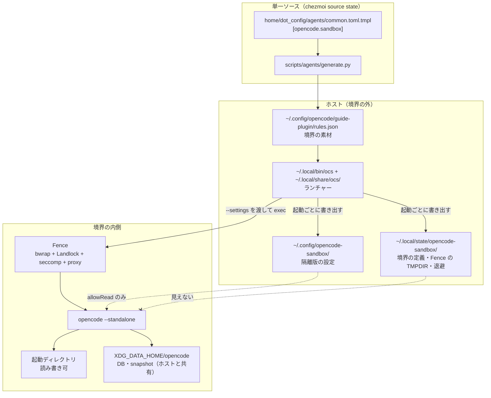
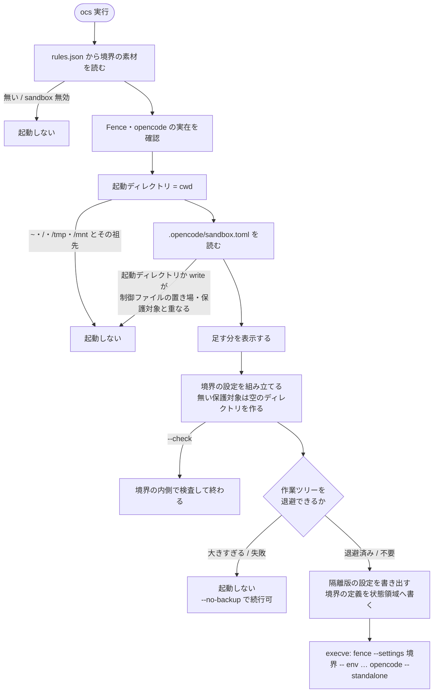
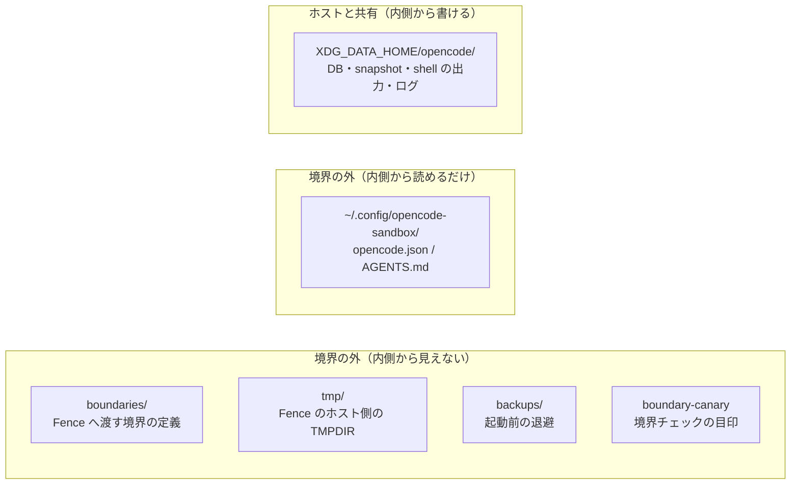

# OpenCode 隔離起動（`ocs`）のアーキテクチャ

OpenCode を OS のアクセス制御で囲って起動する仕組みの構成を書く。
**対象は Ubuntu / WSL のみ**（macOS / Windows は bubblewrap が無いので非対応）。

- 何を守り何を守らないかは [ADR-0012](../../adr/0012-ocs-boundary-for-accidents.md)
  （目的は**エージェントのうっかりの防止**。悪意あるワークスペースやプロンプト
  インジェクションへの耐性は非目的）と [セキュリティ](../security.md#ai-エージェントの実行境界ubuntu--wsl)
- 経緯と候補比較は [CHG-0004](../../change/closed/0004-opencode-sandbox.md)（作った経緯）と
  [CHG-0009](../../change/closed/0009-ocs-simplify-for-accidents.md)（Fence への切り替えと簡素化）
- ここは**現在の構成**だけを書く
- 書き溜めた経緯・実測は [`ocs` 境界の仕様の補足記録](../../research/opencode/opencode-sandbox-spec-notes.md)

> この文書の『境界の中身』『起動前の退避』『境界チェック』『信頼の鎖』は、`pis` と `ocs` が共有する Fence 境界の正本。『状態の置き場』（DB の共有・セッションの引き継ぎ・隔離版設定）『エージェントとコマンド』『OCS_ISOLATED』は OpenCode 専用（撤去予定。CHG-0020 段 6 は保留中）。

```bash
ocs          # 隔離起動（境界の内側で起動する）
ocs --check  # 起動せず、この起動ディレクトリの境界を内側から検査する
opencode     # 通常起動（境界なし）
```

## 中心にある考え方

- **包む単位はプロセス全体**。`opencode --standalone` ごと [Fence](https://github.com/fencesandbox/fence)
  （bubblewrap・Landlock・seccomp とドメイン単位のプロキシ）の内側へ入れる
- コマンド文字列を検査しない。判定は「効果が境界の外に出るか」だけ
- **境界を張れないときは起動しない。** 通常起動へ落とすなら境界ではない
- **守るのは「境界の外」であって「境界の中」ではない。** 起動ディレクトリ以下は
  無条件に読み書きできる。**モデル API の資格情報も内側にある**（DB の中。
  [既知の制約](#既知の制約)）
- **履歴は通常起動と共有する。** DB とデータディレクトリ（`XDG_DATA_HOME/opencode`）を
  境界の内外で同じものにする。内側で作ったセッションは外の `opencode -s <ID>` で再開できる

> **なぜ shell だけでは足りないか。** OpenCode はプロジェクト設定から
> permission を上書きでき、`.opencode/plugins/` は自動ロードされ、`mcp` は
> プロセスを起動する。ツール層だけ塞いでも、同じプロセスの中から回避される
> （[permission の穴 §5](../../research/opencode/permission/gaps.md#5-プロジェクト設定がグローバルの-deny-を上書きする2026-09-23-再確認)）。

## 通常起動と `ocs` の使い分け

> OpenCode 専用（撤去予定。CHG-0020 段 6 は保留中）。pi の仕様は [境界の中身](fence-boundary.md#境界の中身)。

分けるのは**境界を張るかどうか**で、エージェントではない。`bypass`（通常と同じ permission のまま、
確認（`ask`）だけを guide plugin が `allow` にするエージェント。[ADR-0014](../../adr/0014-bypass-as-ask-upgrade.md)）は
どちらでも使えるが、外れるものが違う。

| | 通常の `opencode` | `ocs` |
| --- | --- | --- |
| OS の境界 | なし | Fence |
| `bypass` で外れるもの | permission の確認（`ask`）だけ。静的 deny（秘密ファイル・`pip` など）と誘導は効く | 同じく確認だけ。境界の外の秘密は見えず、`git push` などは policy で止まる |
| 向く作業 | 詰まったときの復旧、制御ファイルの編集、`chezmoi apply` | ふだんの作業を確認なしで進める |

制御ファイルの置き場や保護対象の中では、`ocs` は起動を断る（[起動ディレクトリの制限](fence-boundary.md#起動ディレクトリの制限)）。
そこの編集は通常の `opencode` で行う。

`ocs` の中でも `bypass` を使える。経緯は [補足記録](../../research/opencode/opencode-sandbox-spec-notes.md#bypass-を-ocs-で使えるようにした経緯)。

## 全体像



要点は 2 つ。

- **設定の実体は境界の外**にあり、内側からは読めても書けない。
  ソース（このリポジトリ）は内側で編集できるが、**自分で有効化はできない**
  （効く範囲は[制御ファイルの保護が効く範囲](fence-boundary.md#制御ファイルの保護が効く範囲)）
- **境界の定義と退避はさらに外**（`~/.local/state`）に置く。内側からは見えない

## 起動シーケンス

> OpenCode 専用（撤去予定。CHG-0020 段 6 は保留中）。pi の仕様は [pi のガード](../guard/pi-guard.md#サンドボックス)。



順序で効いている点。

- **起動ディレクトリの制限は境界を組み立てる前**。広すぎる場所で境界を一度作ってから
  捨てることにしない
- **退避は境界を張る前**。ホスト側で行うので、内側からは改竄できない
- 起動時に確認や検査で待たない。境界チェックは `ocs --check` で手動で走らせる
  （[境界チェック](fence-boundary.md#境界チェック)）

> `pis` と `ocs` が共有する Fence 境界（境界の中身・起動前の退避・境界チェック・信頼の鎖・版の扱い）は [Fence 境界の組み立て](fence-boundary.md) へ移した。この文書には、OpenCode の隔離起動（`ocs`）だけの仕様が残っている。

## 状態の置き場



| 置き場 | 中身 | なぜそこか |
| --- | --- | --- |
| `~/.local/state/opencode-sandbox/` | 境界の定義・Fence の TMPDIR・退避・目印 | 内側から見えず、重なる場所での起動も拒否する（[起動ディレクトリの制限](fence-boundary.md#起動ディレクトリの制限)）。chezmoi が apply で先に作る（[信頼の鎖](fence-boundary.md#信頼の鎖)） |
| `~/.config/opencode-sandbox/` | 隔離版の `opencode.json`・`AGENTS.md`（OpenCode 専用。撤去予定。CHG-0020 段 6 は保留中。pi は起動ごとの agent 置き場を使う。[pi のガード](../guard/pi-guard.md#サンドボックス)） | 緩和設定を内側から広げられないようにする。書き手は常に外（[効く範囲](fence-boundary.md#制御ファイルの保護が効く範囲)） |
| `XDG_DATA_HOME/opencode/` | DB・snapshot・shell の出力・ログ（OpenCode 専用。撤去予定。CHG-0020 段 6 は保留中） | 通常起動と共有する（下記） |

- **境界の定義は起動ごとに書き、24 時間より古いものを次の起動で捨てる。**
  `execve` で置き換わるので自分では消せない
- **Fence のホスト側の `TMPDIR` は `tmp/` に固定する。** Fence は起動ごとに
  `fence-seccomp/*.bpf` を残すので、10 分より古いものを次の起動で捨てる。
  プロキシのソケットもここに作られ、Fence が終了時に消す
- 内側の `TMPDIR` は `/tmp`（内側の tmpfs）に戻す。ホスト側の値のままだと、
  内側から見えない場所を指したまま書けない

### DB の共有

> OpenCode 専用（撤去予定。CHG-0020 段 6 は保留中）。pi の仕様は [境界の中身](fence-boundary.md#境界の中身)。

内側で `XDG_DATA_HOME` と `OPENCODE_DB` を上書きしない。`ocs` は外側で
`XDG_DATA_HOME/opencode`（未設定なら `~/.local/share/opencode`）を解決し、
`allowWrite` に入れる。利用者の環境の `OPENCODE_DB` は**落とす**（残ると常駐サービスと
別の DB を使い、履歴が分かれる）。

- 同時書き込み・外での再開・外からの `/undo` は実測で通った
  （[DB の共有の調査](../../research/opencode/shared-db.md)、CHG-0009 の実装・検証）
- **`~/.local/state/opencode/` は開けない。** 常駐サービスの接続情報 `service.json` がある。
  opencode は起動時にそこへディレクトリを作るので、内側の `XDG_STATE_HOME` は
  `/tmp/xdg-state`（内側の tmpfs）へ向ける。内側で選んだモデルと入力履歴は残らない
- **同じセッションを境界の内と外で同時に開かない**（同時の操作は未検証）
- OpenCode を更新したら常駐サービスも再起動する。古い版の常駐サービスと新しい版の
  内側が同じ DB を使うと、スキーマの移行で壊れうる（推測）

### セッションの引き継ぎ

> OpenCode 専用（撤去予定。CHG-0020 段 6 は保留中）。pi の仕様は [境界の中身](fence-boundary.md#境界の中身)。

DB を共有しているので、内側で作ったセッションは OpenCode が終了時に表示する
`opencode -s <ID>` で**そのまま**外から再開できる。移送の操作は無い。

以前の版の起動ディレクトリごとの隔離用 DB（`<起動ディレクトリ>/.opencode-sandbox/`）は `ocs` が消さない。中の古いセッションの開き方と、消してよいものは [補足記録](../../research/opencode/opencode-sandbox-spec-notes.md#以前の隔離用-db-の移行案内)。

### 隔離版の設定の書き出し方

> OpenCode 専用（撤去予定。CHG-0020 段 6 は保留中）。pi の仕様は [境界の中身](fence-boundary.md#境界の中身)。

- 緩和に関わるキー（`permissions` / `snapshots` / `policies` / `plugins`）は
  **毎回差し替える**。生成側が空なら取り除く（`AGENTS.md` も同じ）。
  `permissions` だけは空でも `[]` を書く（消すと OpenCode の既定に戻るため）
- `common.toml` のエージェントとコマンド（`agent` / `agents` / `commands`）も**毎回丸ごと
  差し替える**（下記）
- それ以外のキーは**残す**。丸ごと上書きすると TUI で選んだ値が毎回消える
- 通常版の設定からは**見た目・操作感のキーだけ**引き継ぐ
  （`theme` / `keybinds` / `username` / `layout` / `model` / `small_model`）
- 既定モデルは初回だけ、`model_preference` の順で DB に資格情報がある provider を選ぶ

> 許可リストで持つこと。`permissions` や `plugins` を引き継げるようにすると、
> 境界の外の設定で内側の緩和を決められてしまう。

#### エージェントとコマンド

> OpenCode 専用（撤去予定。CHG-0020 段 6 は保留中）。pi の仕様は [境界の中身](fence-boundary.md#境界の中身)。

`common.toml` の `[opencode.agent]`（`bypass`・`bypass-worker`）・`[opencode.agents]`
（`commit`・`review`・`fleet-worker`）・`[opencode.commands]`（`/fleet`）を、隔離版にも
出す（[CHG-0010](../../change/closed/0010-ocs-agents.md)）。境界の目的をうっかりの防止に絞ったので
（[ADR-0012](../../adr/0012-ocs-boundary-for-accidents.md)）、境界の中で `bypass` を使ってよい。

| キー | 中身 | 既存の扱い |
| --- | --- | --- |
| `agent` / `agents` / `commands` | 通常版の `opencode.json` と同じ関数（`merge_opencode_agents` など）で、空の既存に対して組んだもの | **丸ごと差し替える**。宣言が空なら取り除く |
| `agents.<id>.model` | `[opencode.model.agents]` の割り当て。この PC のプロバイダが `[opencode.sandbox] providers` にあるときだけ | 同上 |
| `providers.<id>.settings` | 同じ条件で、`[provider.<id>]` の `profile` / `region` | **キー単位で上書きする**。宣言したキーだけを書き、未宣言のキー（利用者が足した `baseURL` など）・宣言から外したキー・他のプロバイダは残す（通常版の `merge_opencode_providers` と同じ） |

- **通常版の `opencode.json` からは引き継がない。** 手で足したエージェントまで入り、
  単一ソースが崩れるため。`generate.py` が `rules.json` の `sandbox` 節へ出し、
  `ocs` がそれを書く
- **宣言外のエントリも残さない**（通常版の `merge_opencode_agents` は残す）。隔離版の設定は
  境界の内から書けないので、TUI の操作で足されるものは無い。残るのは `common.toml` から
  外した古い定義か外で手書きしたものだけで、前者が全部 allow のエージェントだと、
  外したはずの緩和が隔離版に居座る。エージェントの権限は緩和に関わるキーとして扱う
- **届かないプロバイダのモデルは割り当てない。** Bedrock は `ocs` では使えない
  （[モデルの割り当て](../opencode-config-generation.md#隔離起動ocs)）ので、Bedrock の PC では
  子エージェントは親のモデルで動く。接続設定も同じ理由で出さない
- **シェルの確認は通常起動より少ない。** 隔離版の全体の規則はシェルの既定が `allow`
  （`[opencode.sandbox.permissions] default_shell_effect`）で、`rm` などの
  `ask` も捨てている（`drop_shell`）。エージェントの `permissions` は後勝ちでそのまま効くので、
  `commit`（読むだけ）や `fleet-worker` の git 操作の deny は残るが、それ以外は個別の deny / ask に
  当たらなければ確認なしで通る。
  **`git commit` の `ask` は捨てない**（会話での承認に加えて、実行時の確認を残す）。
  オプションを前に置いた `git -c … commit` は `ask` に当たらないので、guide 規則で止める
  （[コミットの確認](../agent-config-generation.md#コミットの確認)）
- **作業ツリーの外の読み取りは、通常版と同じく確認なし。** `external_directory` の `allow`
  （スキルの置き場と `work_read`）は隔離版にも出し、同じ場所への edit の `ask` も残す
  （[作業ツリーの外の読み取り](../agent-config-generation.md#作業ツリーの外の読み取り)）。
  スキルのスクリプト用の規則は出さない。隔離版の shell は既定が `allow` なので、出しても
  拒否が増えるだけ（[スキルのスクリプト](../agent-config-generation.md#スキルのスクリプト)）
- `bypass-worker` を `bypass` 以外から起動させない仕組み（全体の `subagent` の deny と
  guide plugin の起動元の検査）は、隔離版でもそのまま効く
  （[bypass から呼べる子エージェント](../opencode-config-generation.md#bypass-から呼べる子エージェント)）
- `bypass` の中でも `experimental.policies`（`git push` / `chezmoi apply` など）は止まる
  （実機で確認）。秘密ファイルの読み取りの deny も、guide plugin の誘導・伏字化・
  `grep` / `glob` の結果フィルタも `bypass` に効く（`bypass` が緩めるのは `ask` → `allow` だけ。
  [ADR-0014](../../adr/0014-bypass-as-ask-upgrade.md)）。ワークスペースの中の `.env` / `.env.*` も
  deny で読めない（`.env.example` などのサンプルは例外）
- プロバイダの `provider.use` の policy（通常版がこの PC のプロバイダ以外を塞ぐもの）は
  隔離版には出さない。隔離版で使えるプロバイダは通信先の許可（`[opencode.sandbox] providers`）
  が決め、既定モデルも `model_preference` で選ぶため。通常版と同じ policy を置くと、
  Bedrock の PC では `ocs` のモデルがすべて塞がる

一時の設定・DB と Fence の境界の中で、定義が出ることと `bypass` / `bypass-worker` の
起動の制限が効くことを確かめた（[CHG-0010](../../change/closed/0010-ocs-agents.md) の実装・検証）。

内側の環境には `OCS_ISOLATED=1` を渡す。guide plugin はこれで隔離起動を見分け、
確認画面の説明の生成（モデルの呼び出し）だけを止める。偽装されても説明が出なくなるだけで、
判定には効かない。止めているのはモデルの呼び出しだけで、モデルを呼ばない `git commit` の件名と本文の表示は隔離起動でも出る（[`git commit` の件名と本文](../agent-config-generation.md#git-commit-の件名と本文)。止めた経緯は[補足記録](../../research/opencode/opencode-sandbox-spec-notes.md#ocs_isolated-でモデルの説明を止めた経緯)）。

## コマンドとフラグ

> OpenCode 専用（撤去予定。CHG-0020 段 6 は保留中）。pi の仕様は [pi のガード](../guard/pi-guard.md#起動)。

`ocs` が解釈しない引数は、そのまま OpenCode へ渡る（`ocs --continue`、`ocs -s <ID>` など）。
Fence へは引数を並べて渡すので、引用の心配は無い。

| フラグ | 用途 |
| --- | --- |
| `--no-backup` | 起動前の退避をしない |
| `--check` | 起動せず、境界を内側から検査する（[境界チェック](fence-boundary.md#境界チェック)） |

## 既知の制約

| 制約 | 内容 |
| --- | --- |
| セッション中に境界を変えられない | bwrap の名前空間はプロセス起動時に作られる。`/add-dir` 相当は無い |
| コマンド単位の逃げ道が無い | プロセス単位で包む以上、`dangerouslyDisableSandbox` 相当は作れない |
| 設定が通常起動と分かれる | OpenCode 専用（撤去予定。CHG-0020 段 6 は保留中）。隔離版の設定は `~/.config/opencode-sandbox`。履歴（DB）は共有する |
| 境界はエージェントから見えない | `ENOENT` を「存在しない」と誤診する。`AGENTS.md` で明示的に伝えている |
| 起動が遅くなる | Fence の機能の検出など（[実測](../../research/opencode/permission/fence.md)。値は[補足記録](../../research/opencode/opencode-sandbox-spec-notes.md#起動時間の実測値)） |
| 起動ディレクトリに `.opencode/` が作られる | 保護対象を塞ぐため。空のディレクトリで、`git status` には出ない |
| **資格情報は境界内にある**（決めた例外） | OpenCode 専用（撤去予定。CHG-0020 段 6 は保留中）。共有する DB が `credential` を持ち、内側から**平文で取り出せる**。無いとモデルへ繋げないため、[明示的な例外として受け入れた](../../change/closed/0004-opencode-sandbox.md#決定-明示的な例外として受け入れる2026-09-24)。見落としではない |
| 他のプロジェクトの会話が読める | OpenCode 専用（撤去予定。CHG-0020 段 6 は保留中）。DB を共有するため。ADR-0012 で保証しないと決めた |
| 開けた作業用ディレクトリの中の秘密は読める | `work_read` は秘密を置かない場所だけにする |
| 起動ディレクトリがリポジトリの下位ディレクトリだと、そのリポジトリの `.git` が書ける | worktree と同じ扱いで共有 `.git` を開けるため（`hooks` と `config` は除く） |

[仕様一覧へ戻る](../index.md)
