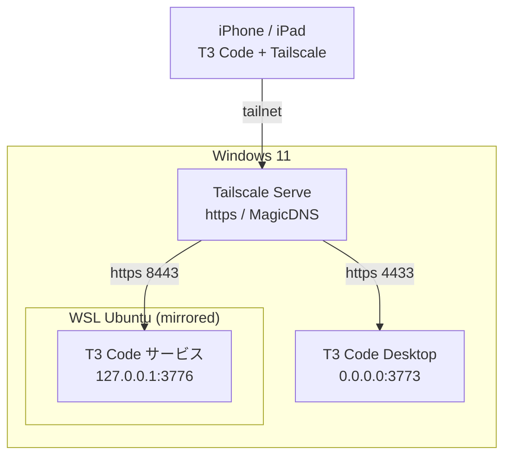

# T3 Code のリモートアクセス（Windows と WSL・Tailscale）

Windows 版と WSL の T3 Code を、Windows 側の Tailscale Serve だけで tailnet（利用者の Tailscale 網）へ出す。
ポートは固定し、chezmoi がその固定と Serve の公開を整える。UI の設定とペアリングは手動である。
対象は家の機（`is-work` が false）だけである。会社 PC には、T3 Code の設定を何も入れない。

## 構成

iPhone などの端末は、tailnet 経由で Windows の Tailscale Serve に入る。Serve は https のポートごとに、別の T3 Code へ転送する。



| 項目 | Windows | WSL |
| --- | --- | --- |
| T3 Code | Desktop（アプリ） | バックグラウンドサービス（`t3 service`） |
| HTTP ポート | `3773` | `3776` |
| 待ち受けるアドレス | `0.0.0.0`（Network access が ON） | `127.0.0.1` |
| tailnet の https | `4433` | `8443` |
| Tailscale | 使う | 使わない（`tailscaled` は止めたまま） |
| T3 Connect | 使わない | 使わない |

- Serve の公開は tailnet だけである。`tailscale funnel` は使わない
- WSL の待ち受けは `127.0.0.1` に限る。LAN には出さない
- **Windows 版は LAN からも直接届く。** Network access が ON のため `0.0.0.0:3773` で待ち受ける。守っているのはペアリングコードだけである（[限界](#限界)）
- WSL の `127.0.0.1:3776` は、`.wslconfig` の `networkingMode=mirrored` で Windows から同じアドレスで届く
- Tailscale を WSL 側にも入れると、MTU やトンネルの二重化で通信が不安定になる。Windows 側だけにする（[Tailscale の WSL 2 の文書](https://tailscale.com/docs/install/windows/wsl2)）

## chezmoi が整えるもの

どれも冪等で、家の機だけに入る。判定は `is-work`（[Web 検索の配る範囲](web-search.md#配る範囲) と同じ）である。

| 対象 | スクリプト | 内容 |
| --- | --- | --- |
| WSL の `~/.t3/service.env` | `100_linux/run_after_127_t3code_service_env.sh.tmpl` | `T3CODE_PORT=3776` と `T3CODE_HOST=127.0.0.1` を書く |
| Windows のユーザー環境変数 | `300_windows/run_after_353_t3code_port.ps1.tmpl` | `T3CODE_PORT=3773` を書く |
| Windows の Tailscale Serve | `300_windows/run_after_354_t3code_wsl_serve.ps1.tmpl` | https `8443` を `http://127.0.0.1:3776` へ公開する |

- **`service.env` は該当のキーだけを書き換える。** ほかの行とコメントは残す。ファイルが無ければ権限 `600` で作る。`~/.t3` が無ければ何もしない
- **`service.env` は、別のファイルを作って置き換える。** 一時ファイルは、同じ場所の本人だけが入れるディレクトリに置く。元の権限を引き継ぎ、symlink なら実体を書き換える
- **処理中に `service.env` が変わったら、書き換えない。** `t3 up` などが書き足した行を消さないためである。警告して終わり、次の `apply` でやり直す。ロックは無いので、読んでから置き換えるまでの短い間は競合しうる
- **WSL のサービスは自動で再起動しない。** 再起動は、実行中のエージェントの処理を止める。反映には `t3 service restart` を手で実行する
- **Serve は、現状を確認できたときだけ設定する。** `tailscale serve status` が失敗するか、壊れた出力を返したら、何も変えずに警告して終わる
- **Serve は、使われている https ポートを上書きしない。** `8443` が別の転送先（TCP の公開を含む）を指していれば、警告して終わる。置き換えるコマンドは警告に出る
- **Serve は、`8443` が funnel で公開されていたら何も変えない。** 同じ転送先でも「設定済み」とは見なさず、警告する
- **Serve の各呼び出しには時間の上限がある。** 現状の確認は 20 秒、設定は 60 秒である。tailnet の HTTPS 証明書が未許可だと、`tailscale serve` は有効化を待ち続けるためである
- **Tailscale が未導入・未ログインなら何もしない。** どの失敗でも `apply` は止めない（警告して 0 で終わる）
- **Windows の `T3CODE_PORT` は、環境が更新された起動元から Windows 版を開いたときに効く。** すでに起動しているシェルやランチャーから開くと、古い環境を引き継ぐ。再ログインすれば確実である
- **`DOTFILES_TAILSCALE_EXE` は試験用の入口である。** Serve のスクリプトが呼ぶ `tailscale.exe` を差し替える（PowerShell は `ProgramFiles` を起動時に上書きするので、それでは差し替えられない）

## 手動で行うもの

chezmoi が触らない設定である。T3 Code が自分で管理するか、秘密を含むためである。

| 作業 | 場所 | 内容 |
| --- | --- | --- |
| WSL backend を切る | Windows 版の `Settings → Sharing & access` | ディストリビューションの選択を解除する。WSL のサービスと T3 home（`~/.t3`）を取り合うのを避ける |
| Network access と Tailscale HTTPS | 同上 | どちらも ON。Tailscale HTTPS のポートは `4433` |
| T3 Connect | 同上 | OFF |
| WSL サービスの再起動 | WSL | `t3 service restart`（`service.env` を変えたあと） |
| ペアリング | 各 T3 Code | 下の表。トークンを含む URL が出るので、利用者が実行する |

Windows 版の設定は `~/.t3/userdata/desktop-settings.json` に保存される（`serverExposureMode`・`tailscaleServeEnabled`・`tailscaleServePort`・`wslDistro`）。
アプリが書くので、chezmoi では管理しない。

| ペアリング | 手順 |
| --- | --- |
| Windows → iPhone | Windows 版の設定画面で、`https://<Windows の MagicDNS 名>:4433/` を使ってリンクを発行する |
| WSL → iPhone | WSL で `t3 pair` を実行し、URL の接続先だけを `https://<Windows の MagicDNS 名>:8443/` に差し替える。`--tailscale` は付けない |
| WSL → Windows 版 | WSL で `t3 pair` を実行し、Windows 版の `Settings → Environments → Add environment` に登録する。接続先は `http://127.0.0.1:3776/` |

## 確認

Windows の PowerShell で確かめる。

```powershell
tailscale serve status                     # 4433 → 127.0.0.1:3773、8443 → 127.0.0.1:3776
Get-NetTCPConnection -State Listen -LocalPort 3773   # Network access が ON なら 0.0.0.0（下の限界を参照）
curl.exe http://127.0.0.1:3776/            # WSL のサービスに届くこと
curl.exe -s -o NUL -w "%{http_code}\n" https://<Windows の MagicDNS 名>:8443/
```

```sh
# WSL
ss -ltn | grep 3776                        # 127.0.0.1:3776 だけが LISTEN
t3 status                                  # Local network が overridden · T3CODE_HOST=127.0.0.1
systemctl is-active tailscaled             # inactive
```

## 症状と対応

| 症状 | 原因 | 対応 |
| --- | --- | --- |
| `8443` の警告が出る | 別の転送先が先に `8443` を使っている | `tailscale serve status` で転送先を確かめ、不要なら警告のコマンドで置き換える |
| WSL の URL が 503 | サービスの起動直後 | 数秒後にやり直す。続くなら `~/.t3/userdata/logs/boot-service.log` を見る |
| WSL のポートが変わらない | `service.env` を変えただけで、サービスが古い設定のまま | `t3 service restart` |
| `127.0.0.1:3776` が Windows から届かない | WSL が止まっている、または mirrored でない | `wsl.exe -l -v` と `.wslconfig` を確かめる。常駐は `sandbox-keepalive`（[WSL](platform-wsl.md#リモートから-wsl-へ-ssh-する)） |
| Windows の認証が通らない | Windows と WSL が同じポートを使い、WSL の localhost 転送と競合した | ポートを分ける（この構成の理由）。WSL backend も切る |

## 限界

- **Windows 版の `3773` は、LAN から直接届く。** 2026-11-25 の実機で、`Get-NetTCPConnection` が `0.0.0.0:3773` の LISTEN を示した。Windows Defender ファイアウォールには、T3 Code（`t3 code (beta).exe`）の受信を許可する Private プロファイルの規則が 2 件あり、ネットワークも Private だった。LAN の端末は、ペアリングコードがあれば `3773` に届く
- **この設定は、その露出を変えない。** Network access と Tailscale HTTPS は T3 Code のアプリの設定で、`apply` は触らない。Network access を切っても Tailscale HTTPS が動くかは未確認である
- **対策の候補**（利用者の判断）: ネットワークを Public にする、規則の対象を Tailscale のアドレスに絞る、Network access を切って動作を確かめる
- **WSL 側は `127.0.0.1` だけである。** LAN へも tailnet へも、Windows の Serve を通らずには届かない

## 判断の理由

- **公開の手段**: T3 Code の `t3 pair --tailscale` は、サーバのある機で `tailscale` を呼ぶ。WSL に Tailscale を入れない方針と合わない。Windows 側の `tailscale serve` を使う
- **自作を足さない理由**: 足したのは、既存の chezmoi スクリプトの型（`350_tailscale` と同じ）だけである（[ADR-0031](../adr/0031-evaluate-existing-extensions-first.md)）
- **`service.env` を丸ごと配らない理由**: T3 Code の `t3 up` も、このファイルへ書く。丸ごと配ると、ほかのキーを消す
- **SSH の Serve（50022）との違い**: [WSL の SSH](platform-wsl.md#リモートから-wsl-へ-ssh-する) の Serve は手動のままである。T3 Code の Serve は、利用者の依頼で `apply` のたびに確かめる

## 出典と確認の状況

- **手順の出典**: 利用者が持ち込んだ手順書（ChatGPT の回答を Markdown にしたもの）。実機の確認は含まれない
- **T3 Code の文書**: [背景サービス](https://github.com/pingdotgg/t3code/blob/main/docs/user/background-service.md)と[リモートアクセス](https://github.com/pingdotgg/t3code/blob/main/docs/user/remote-access.md)。2026-11-25 に本文を取得した。`service.env` の書式と、`T3CODE_HOST` が `T3CODE_LAN` に優先することを確認した
- **実機で確かめた**: 2026-11-25、Windows 11 と WSL2（mirrored）の 1 台。WSL が `127.0.0.1:3776` で待ち受け、Windows の `curl.exe` で `4433` と `8443` が 200 だった
- **スクリプトの実行**: Serve のスクリプトは、偽の `tailscale.exe` で 10 経路（空き・空の出力・設定済み・別の転送先・TCP の公開・funnel・状態の取得失敗・壊れた出力・設定の失敗・未ログイン）を、Windows PowerShell 5.1 と pwsh 7 で実行した。実物の `tailscale` では 3 経路（設定済み・競合・未設定）を実行した。時間の上限は、止まらないプロセスで 3 秒の上限が効くことを両方で確かめた（偽の `tailscale.exe` の試験には入れていない）。WSL のスクリプトは、WSL（Ubuntu）で試験を実行した
- **未確認**: iPhone など別の端末からの接続。`chezmoi apply` を通した適用。Windows 版の再起動後に `T3CODE_PORT` が効くこと
