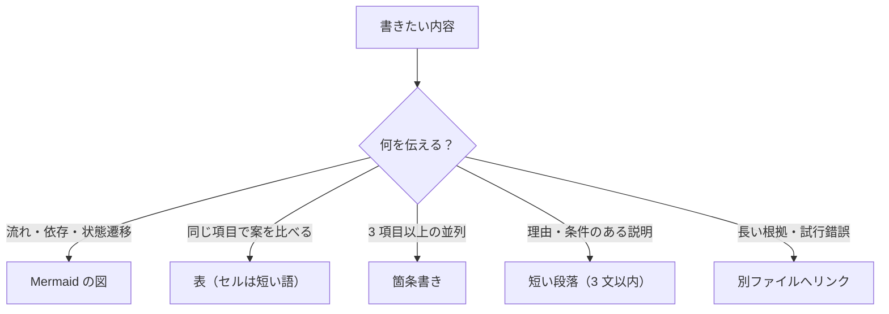
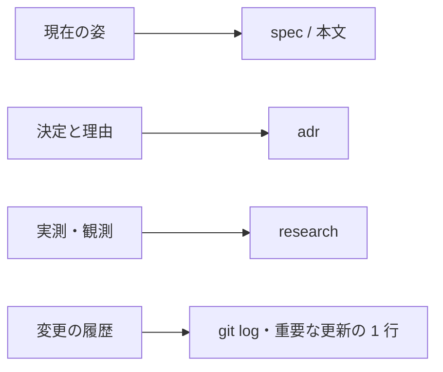

# docs の Markdown の書き方

[共通の Markdown ガイド](markdown-common.md) に加え、SDD の `docs/` で使う書式と記録の規則。

根拠の凡例:

| 印 | 意味 |
| --- | --- |
| 強 | 仕様・実測、または複数の公式ガイドが一致 |
| 中 | 1 つの公式ガイド、または実践報告 |
| 弱 | 解釈・経験則 |
| 目安 | 出典に数値が無い。運用の目安として置く |

出典と実測値は、移行元の [Markdown の調査記録](https://github.com/applejxd/dotfiles/blob/9b0e2670e8d1d8aaf2ddfd314187903f4c8e7432/docs/research/agents/markdown-writing-best-practices-2026-11.md) にある。

## 1. 形を選ぶ

- 迷ったら、段落より箇条書き、箇条書きより表、表より図を先に検討する
- 図だけに重要な情報を入れない。結論は本文か表にも書く

## 2. 文章

| 規則 | 目安 | 根拠 |
| --- | --- | --- |
| 1 文は 100 字以内 | 超えたら分ける | 中 |
| 1 文に論点は 1 つ | 「ので、」「し、」「が、」で繋がない | 中 |
| 読点は 1 文に 3 つまで | 4 つ以上は文の分割の合図 | 中 |
| 段落は 3 文まで | 4 文以上は箇条書きか表へ | 目安 |
| 3 項目以上の並列は箇条書き | 導入の 1 文を付ける | 中 |
| 箇条書きは 7 項目まで | 超えたら見出しで分ける | 中 |
| 結論を先に書く | 冒頭・各節・各段落の第 1 文 | 強 |
| 括弧は 1 文に 2 組まで、入れ子にしない | 重要な情報は括弧に入れない | 中 |
| 用語・略号は初出で定義する | 「上記」「下記」を使わない | 弱 |
| 常体（である調）で統一する | 箇条書きも同じ | 目安 |

- 誇張・曖昧語（「重要な」「様々な」）を避ける。数・名前・出典で書く
- 症状（太字・箇条書きの多さ）だけ消さず、各節が具体的な主張を持つか確かめる

## 3. 構造

- H1 は 1 つ。見出しは 1 段ずつ下げ、H4 以下は使わない（目安）
- 見出しだけ読んで内容が分かる文言にする。「概要」「その他」を繰り返さない
- 冒頭に 1〜3 行の要約を置く（強）
- 1 文書 1 目的。300 行を超えたら分割か `research/` への切り出しを考える（目安）
- 同じ内容を 2 か所に書かず、1 か所に寄せてリンクする
- 注記ブロック（`>`）は 1 節に 1 個まで

## 4. 表

- 向く: 同じ項目で 2〜7 個の案・対象を比べる。対応づける。3 項目以上の関連データ
- セルは 1 事実・40 字以内（目安）。文章・理由・手順は入れない
- 理由が要るなら、表の下に箇条書きか小節を置く
- 列は 5 つまで（目安）。1 列だけなら箇条書きにする
- 空セルは「なし」と書く
- 履歴の表（日付｜変更｜理由）のように、各セルが 1 句なら理由の列があってよい
- セルにはリストも改行も入れられない。`|` は `\|` と書く（強。GFM §4.10）

## 5. 強調

- 太字は、先頭の語（`理由:`）と UI 名だけに使う。文中の強調には使わない
- 1 段落に 2 か所まで（目安）
- 識別子・パス・コマンドは `code` にする
- 太字の開きか閉じが「」・（）・バッククォートに接し、反対側が文字だと、描画が壊れて `**` が残る（強）
  - 壊れる例: `これは**「重要」**です。`（閉じの外側が文字）
  - 動く例: `**「重要」**。`（閉じの外側が句読点）
  - 実測: このリポジトリの docs で 15 か所・9 ファイル
  - 直し方: 太字をやめる。または約物の外側に句読点を置く

## 6. 図（Mermaid）

| 伝えたいこと | 図 |
| --- | --- |
| 流れ・依存・分岐 | `flowchart` |
| 主体どうしのやり取り | `sequenceDiagram` |
| 状態の遷移 | `stateDiagram-v2` |
| 時系列の出来事 | `timeline` |
| データの関係 | `erDiagram` |

- 図の直前に、何を示すかを 1 文で書く（中）
- 半角括弧・記号を含むラベルは `"…"` で囲む。ノード ID は ASCII にする（強。無引用の半角括弧は構文エラー）
- 小文字の `end` をノード ID に使わない（強。構文エラーになる。ラベル中の語は通る）
- 向きを明示する（`flowchart TD` / `LR`）
- 1 図 10 ノードまで、1 図 1 メッセージ。超えたら分ける（弱）
- 色だけに意味を持たせない（弱）
- 新しい機能（beta 図・`@{ shape: }`・edge ID）は避ける。GitHub の版は遅れうる（中）
- 構文は `mermaid.parse`（Node + jsdom）で検査できる。GitHub の版とは別なので、描画の確認は別に要る

## 7. 経緯・履歴

- `spec/` の本文は現在の姿だけを書く。「以前は〜」「〜に変更した」「当初」を書かない（中）
- ADR・調査記録・終了した案件は、保存の規約（`docs-rules.md`）を優先する。書式のために書き換えない
- 「現在」「新しく」「最近」を使わず、日付か版で書く（中）
- 経緯は 1 行の表（日付｜変更｜理由）か `timeline` にする。物語にしない（中）
- 見送った案は表（案｜却下の理由｜再検討の条件）にする（中）
- 決定は 1 決定 1 文書。先頭に結論を 1〜2 文置く（強）
- 長い試行錯誤は `research/` へ置き、本文からリンクする（中）
- 書く基準を決める。実測で覆した・見送った・再発したときだけ書く（中）
- `spec/` の古い記述は直すか消す（強）
- ADR は、全体を覆したら `Superseded` と置換先のリンクを付ける。一部の改定は、冒頭に案内を置く（`docs-rules.md`）

## 8. 日本語

- 全角と半角英数字の間は、半角の空白を入れる（Microsoft 流。JTF 流と逆なので、リポジトリ内で統一する）
- 段落の途中で文を折り返さない。1 文を 1 行にする（弱）
  - 理由: 改行が空白として描画される処理系がある（Firefox は除去、Chrome 系は空白。2023〜2024 年の報告）
- 句読点は「、」「。」。箇条書きは、文なら句点を付け、名詞止めなら付けない（中）
- 日本語の見出しアンカーの挙動は未確認。リンクの切れは `check_refs.py` で確かめる

## 9. 既存の文書

- 触る節だけ直す。一括の書き直しはしない
- `research/` の過去の節は、書式のためでも書き換えない（`docs-rules.md`）
